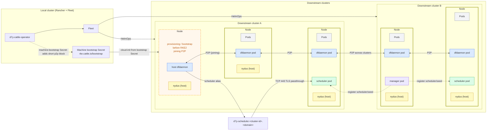

# d7y-cattle-operator

Kubernetes operator that runs [Dragonfly](https://d7y.io) P2P on Rancher-managed
RKE2 clusters.

**Status**: v0.3.18 (2026-11-22). The operator implements the Cluster controller,
role resolution, KeyDB, manager, seed role, manager registration,
`dragonfly-extras`, the fail-open p2p host bootstrap, manager root
credentials, and host nydus. Harbor, registry-proxy, and pod-image admission
webhooks are out of scope.

## What it does today

Pod image-mutation admission, Harbor, and registry-proxy add-ons are out of scope. The operator injects a short p2p bootstrap command plus the shell-quoted bootstrap env into the Rancher machine-bootstrap Secret; the script itself is served by `p2p-static` at a plain URL.

- Parses and validates the operator configuration from flags/environment variables.
- Maintains a stable CA Secret (`dragonfly-p2p-ca`, Opaque) and split leaf
  identities: the shared client `dragonfly-p2p-mtls` (ClientAuth, no SANs), the
  manager `dragonfly-p2p-manager` (manager DNS/IP SANs), and one
  `<cluster>-p2p-scheduler` leaf per seed (scheduler host, Service, and current
  public node IPs). The leaf is delivered by a per-seed
  `<cluster>-p2p-scheduler-cert` HelmOp using the `p2p-scheduler-cert` chart;
  the Secret keeps the name `dragonfly-p2p-scheduler` and the `tls.crt`/
  `tls.key`/`ca.crt` keys. The control HelmOp depends on the scheduler-cert
  label and receives the target's `mtls-cert-revision` through Fleet template
  values. The CA is never regenerated automatically.
- Reconciles `provisioning.cattle.io/v1` Clusters selected by the
  `d7y-operator-cattle: "true"` label.
- Creates a singleton `p2p-static` HelmOp on the manager-labeled Cluster,
  rendering client/nydus/snapshotter versions, repositories, fallback
  checksums, and the manager route from operator config. The existing
  `p2p-static` release is adopted with `takeOwnership`.
- Creates a per-seed `p2p-host-sync` HelmOp that keeps host nydus inputs
  current: `/etc/nydus/{versions,updater}.env`, the updater/selector binaries,
  and a revision-triggered `nydus-updater.service` run without reboot.
- Deploys KeyDB and the Dragonfly manager through Fleet HelmOps, without
  PersistentVolumeClaims. Dragonfly releases use the gorizond fork chart
  `dragonfly 1.10.1-patch.2`, which renders `server.grpc.tls` under `grpc`,
  adds TLS flags to the manager/scheduler `grpc_health_probe` commands, and
  keeps the scheduler headless Service upstream-shaped.
- Deploys the seed role (scheduler/control, seedClient+client/data) when
  `p2p.dragonfly.io/seed: "true"` and a scheduler cluster ID is present. Nydus
  is host-only: `p2p-install.sh` installs and supervises it on the node; the
  operator creates no nydus DaemonSet or HelmOp.
- Manages the manager Ingresses and optional VPAs through the shared
  `d7y-extras` HelmOp and the `dragonfly-extras`
  chart. The operator has no Ingress, IngressRouteTCP, or
  VPA RBAC and creates neither kind directly.
- Uses a JWT-authenticated manager REST client (`pkg/managerapi`) and a
  thread-safe scheduler ID allocator (`pkg/registry`) for seed registration:
  auto mode writes the server-assigned ID to both `scheduler-cluster-id` and
  the durable `scheduler-cluster-id-auto` marker; user-owned IDs are never
  overwritten and mismatches are reported via the `d7y.io/IdMismatch` condition.
  Missing records are recreated and relinked on every reconcile.
- Generates or repairs the manager root credentials Secret (`username`,
  `password`, `jwt-key`) and wires the password/JWT key into the manager; see
  [Manager root credentials](#manager-root-credentials).
- Publishes role/registration state as Cluster conditions
  (`d7y.io/RolesResolved`, `d7y.io/KeyDBReady`, `d7y.io/ControlReady`,
  `d7y.io/DataReady`, `d7y.io/Registered`) and updates them only when they
  change.
- Runs until it receives `SIGINT`/`SIGTERM`.

## How it works



Color legend: gray = workload pods, blue = dfdaemon, green = scheduler, purple = manager, yellow = nydus (host); orange dashed = node still provisioning before RKE2.

### At a glance

- The operator runs on the local Rancher/Fleet cluster. It reconciles every Cluster labelled `d7y-operator-cattle: "true"` and creates the Fleet HelmOps for KeyDB, manager, scheduler/seed, extras, the
containerd mirror, the singleton p2p-static server, and per-seed host-sync. Its machine-bootstrap Secret controller inserts a short p2p bootstrap block (env in the Secret, script served by `p2p-static`) into the node-driver bootstrap script that Rancher merges into cloud-init, before the Rancher `do_install "$@"` call.
- Every running downstream node has a dfdaemon pod, with nydus on the host; pods pull through the node-local proxy and Dragonfly distributes blobs P2P. The diagram shows a scheduler pod per seed cluster and the manager pod on a node in downstream cluster B.
- The orange dashed node in downstream cluster A consumes that bootstrap Secret through cloud-init before RKE2: it has only the host dfdaemon and nydus and is already joining P2P. The scheduler alias `d7y-scheduler.<cluster-id>.<domain>` is published by external-dns (or a wildcard zone) and used before RKE2 to bootstrap node/RKE2 image pulls.

### Multi-cluster topology

- The manager is a role, not a fixed local component: the diagram places the purple manager pod on a node in downstream cluster B, while any Cluster with `d7y-operator-manager` can run it; the operator stays on the local Rancher cluster. Green scheduler pods are per seed Cluster, and blue dfdaemon pods run on every running node. Manager and seed roles may be split across different Clusters, each with its own KeyDB/extras release.
- N downstream/seed Clusters have N scheduler IDs. Each seed Cluster runs its own scheduler + seed under its ID. The scheduler/seed for a new Cluster's ID runs in a seed Cluster reachable before the new Cluster's RKE2 (it cannot run in that Cluster before its own RKE2 exists); external-dns or a wildcard zone publishes `d7y-scheduler.<cluster-id>.<domain>`. In downstream cluster A, the orange dashed node is the pre-RKE2 bootstrap stage: its host dfdaemon joins P2P before RKE2 and any Kubernetes Pods exist.
- `p2p-install.sh` fetched by the machine-bootstrap Secret from `p2p-static` + the host dfdaemon bootstrap start before RKE2 and pull node/RKE2 images via Dragonfly P2P from the scheduler/seed. This accelerates provisioning before the Kubernetes node starts; if the alias is unreachable, the script is fail-open and pulls directly.

## Follow-ups

- Remaining pilot work: cold cross-node P2P, fscache/EROFS on a kernel with
  `EROFS_FS_ONDEMAND`/`CACHEFILES_ONDEMAND`, and full envtest coverage. The
  manager/seed/nydus path is verified on the pilot.
- The extras chart's VPA targetRef names must be verified against live workload
  names in the pilot.
- The KeyDB chart is external: `enapter/keydb` `0.48.0` from
  `https://enapter.github.io/charts/`. It is not vendored in this repo. The
  HelmOp requests two active multi-master nodes with persistence disabled. See
  [Release](#release).

## Install

Install the published chart from the GitHub Pages Helm repository:

```bash
helm repo add gorizond https://gorizond.github.io/d7y-cattle-operator
helm repo update
helm install d7y-cattle-operator gorizond/d7y-cattle-operator \
  --namespace dragonfly-system \
  --create-namespace \
  --set manager.grpcDomain=manager-grpc.example.com \
  --set manager.apiURL=https://manager-api.example.com \
  --set nginx.staticURL=https://static.example.com \
  --set managerApiCredentialsSecret=dragonfly-manager-api \
  --set scheduler.domain=example.com
```

`scheduler.domain` has no default and is required. It builds the per-seed
scheduler DNS SAN `d7y-scheduler.<cluster-id>.<domain>`; scheduler clients dial
the scheduler node IPs on `8002`. There is no public scheduler IP value.

For local development use `charts/d7y-cattle-operator` instead of the repository
chart. The release tag (`v<chart version>`) and the default image tag
(`v<chart version>`) are kept in sync by the release workflow.

The operator reads credentials only from Secret names. No secret values are passed
through flags or chart values; `managerApiCredentialsSecret` is required by the
configuration contract. When the named Secret is absent, the
operator creates it in its own namespace with a generated manager root password
and JWT signing key; see [Manager root credentials](#manager-root-credentials).

### Configuration values

| Value | Environment variable | Description |
|---|---|---|
| `manager.grpcDomain` | `MANAGER_GRPC_DOMAIN` | Public manager gRPC hostname, without scheme |
| `manager.grpcPort` | `MANAGER_GRPC_PORT` | Public manager gRPC port used by schedulers; default `443` |
| `manager.apiURL` | `MANAGER_API_URL` | Public manager REST API URL (`https://`) |
| `nginx.staticURL` | `NGINX_STATIC_URL` | Base URL for the `p2p-install.sh` endpoint and the static client/nydus/snapshotter assets; may be the manager host when the p2p-static manager route is enabled. |
| `nydus.mirrorURL` | `NYDUS_MIRROR_URL` | Optional HTTPS mirror path for nydus blobs in the bootstrap payload |
| `scheduler.domain` | `P2P_DOMAIN` | Base domain for `d7y-scheduler.<fleet-cluster-id>.<domain>`; required |
| `scheduler.clusterID` | `P2P_CLUSTER_ID` | Optional fallback when provisioning Cluster `status.clusterName` is empty |
| `managerApiCredentialsSecret` | `MANAGER_API_CREDENTIALS_SECRET` | Secret with `username`, `password`, and `jwt-key` for the manager API and manager root login; generated by the operator when absent |
| `dragonfly.chart.repo` | `DRAGONFLY_CHART_REPO` | Helm repository URL of the Dragonfly chart; defaults to the gorizond fork |
| `extras.chart.repo` | `EXTRAS_CHART_REPO` | Helm repository URL of the dragonfly-extras chart |
| `extras.chart.name` | `EXTRAS_CHART_NAME` | dragonfly-extras chart name |
| `extras.chart.version` | `EXTRAS_CHART_VERSION` | dragonfly-extras chart version |
| `hostSync.chart.repo` | `HOST_SYNC_CHART_REPO` | Helm repository URL of the p2p-host-sync chart |
| `hostSync.chart.name` | `HOST_SYNC_CHART_NAME` | p2p-host-sync chart name |
| `hostSync.chart.version` | `HOST_SYNC_CHART_VERSION` | p2p-host-sync chart version |
| `schedulerCert.chart.repo` | `SCHEDULER_CERT_CHART_REPO` | Helm repository URL of the p2p-scheduler-cert chart |
| `schedulerCert.chart.name` | `SCHEDULER_CERT_CHART_NAME` | p2p-scheduler-cert chart name |
| `schedulerCert.chart.version` | `SCHEDULER_CERT_CHART_VERSION` | p2p-scheduler-cert chart version; default `0.1.0` |
| `static.chart.repo` / `.name` / `.version` | `STATIC_CHART_REPO` / `STATIC_CHART_NAME` / `STATIC_CHART_VERSION` | p2p-static chart location; default `p2p-static 0.1.12` |
| `static.releaseName` | `STATIC_RELEASE_NAME` | Helm release name for the singleton p2p-static release; default `p2p-static` |
| `releases.client` / `.nydus` / `.snapshotter` | `CLIENT_RELEASE_REPO` / `NYDUS_RELEASE_REPO` / `NYDUS_SNAPSHOTTER_RELEASE_REPO` | GitHub release repositories |
| `versions.client` / `.nydus` / `.snapshotter` | `CLIENT_VERSION` / `NYDUS_VERSION` / `NYDUS_SNAPSHOTTER_VERSION` | Canonical client/nydus/snapshotter versions; defaults `v1.5.14` / `v2.4.5` / `v0.16.0`. The p2p-static and p2p-host-sync charts carry no version defaults. |
| `checksums.*` | `CLIENT_SHA256_*`, `NYDUS_SHA256_*`, `NYDUS_SNAPSHOTTER_*`, `NYDUS_SNAPSHOTTER_BINARY_SHA256_*` | Canonical fallback pins rendered into both P2P charts; release checksum sidecars are preferred |
| `extras.ingress.controller` | `EXTRAS_INGRESS_CONTROLLER` | `nginx` (default) or `traefik` |
| `extras.ingress.className` | `EXTRAS_INGRESS_CLASS_NAME` | Ingress class; empty uses the cluster default |
| `extras.ingress.grpcEnabled` | `EXTRAS_INGRESS_GRPC_ENABLED` | Render the manager gRPC front when the manager role is active; default `true` |
| `extras.ingress.restEnabled` | `EXTRAS_INGRESS_REST_ENABLED` | Render the REST Ingress when the manager role is active; default `true` |
| `extras.ingress.tlsSecret` | `EXTRAS_INGRESS_TLS_SECRET` | Ingress TLS Secret; empty disables the TLS block |
| `extras.ingress.traefikServersTransportEnabled` | `EXTRAS_TRAEFIK_SERVERS_TRANSPORT_ENABLED` | Render the REST Traefik `ServersTransport`; default `true` |

Defaults: `mtlsSecretName=dragonfly-p2p-mtls`, `dragonfly.chart.name=dragonfly`,
`dragonfly.chart.repo=https://gorizond.github.io/dragonflyoss-helm-charts`,
`dragonfly.chart.version=1.10.1-patch.2`, `extras.chart.name=dragonfly-extras`,
`extras.chart.version=0.1.10`, `hostSync.chart.name=p2p-host-sync`,
`hostSync.chart.version=0.1.5`, `schedulerCert.chart.name=p2p-scheduler-cert`,
`schedulerCert.chart.version=0.1.0`, `static.chart.name=p2p-static`,
`static.chart.version=0.1.12`, `static.releaseName=p2p-static`,
`extras.ingress.controller=nginx`,
`extras.ingress.grpcEnabled=true`, `extras.ingress.restEnabled=true`,
`manager.grpcPort=443`, `leaderElect=false`. Version defaults are
`v1.5.14` / `v2.4.5` / `v0.16.0`; snapshotter binary pins default to the
verified amd64/arm64 v0.16.0 hashes. These values are the single source for the
P2P charts. Scheduler node IPs come from
downstream scheduler pods/CAPI Machines; there is no scheduler IP value.
`scheduler.domain` has no default and is required.
`scheduler.clusterID` is only a fallback for an unpopulated
`status.clusterName`.

## Roles and Fleet targeting

Fleet matches `spec.targets[].clusterSelector` against provisioning Cluster
**labels**, so the gate and role labels are the only targeting contract. The
operator still resolves roles from annotations for its own decisions; the
matching role label must also be present for Fleet to render the shared release.

| Label | Value | Meaning |
|---|---|---|
| `d7y-operator-cattle` | `"true"` | Gate: opts the Cluster into the Dragonfly stack |
| `d7y-operator-manager` | `"true"` | Manager role (shared `d7y-manager`) |
| `d7y-operator-seed` | `"true"` | Seed role (shared control/data/extras/mirror) |

Role labels are user-managed: the operator stamps
`p2p.dragonfly.io/cluster-id` (from `status.clusterName`, read by the scheduler
host template) and `p2p.dragonfly.io/scheduler-ips`. A seed Cluster publishes
its own public CAPI machine IPs; a non-seed Cluster aggregates the scheduler-ips
of other gated seed clusters. The same annotation feeds the
pre-install bootstrap and the shared scheduler advertiseIP. An empty list is
removed so the bootstrap installs the host pieces without starting dfdaemon.
Removing a role annotation is not enough to uninstall a shared release; remove
the role label too.

A Cluster labeled `d7y-operator-cattle: "true"` gets the shared KeyDB release.
The role annotations and matching labels add:

| Roles | HelmOps |
|---|---|
| gate only | `d7y-keydb` |
| `manager: "true"` | `d7y-keydb`, `d7y-manager`, `p2p-static` |
| `seed: "true"` + scheduler ID | `d7y-keydb`, `d7y-control`, `d7y-data`, `d7y-extras`, `d7y-containerd-mirror` |
| manager + seed | shared seed set + `d7y-manager` |

The `seed` annotation is independent of the manager role. Removing it deletes
the per-cluster seed HelmOps; the shared releases stop targeting the Cluster
only when the matching role label is removed.

### Shared HelmOps

A small fixed set of HelmOps fans out to Clusters by label selector. The HelmOp
name and Helm release name are fixed (`spec.helm.releaseName` is not
templatable); per-cluster resource names are rendered from Fleet values
templates.

| HelmOp / release | Component | Selector |
|---|---|---|
| `d7y-keydb` | KeyDB | `d7y-operator-cattle=true` |
| `d7y-manager` | manager + MySQL | `d7y-operator-cattle=true`, `d7y-operator-manager=true` |
| `d7y-control` | scheduler | `d7y-operator-cattle=true`, `d7y-operator-seed=true` |
| `d7y-data` | seedClient + client | same as control |
| `d7y-extras` | extras (VPA, manager Ingress) | same as control |
| `d7y-containerd-mirror` | node containerd mirror | same as control |
| `p2p-static` | static asset server (adopted release `p2p-static`) | `d7y-operator-cattle=true`, `d7y-operator-manager=true` |

The rendered values keep the per-cluster downstream names:

- `fullnameOverride`: `${ .ClusterName }` (manager),
  `${ .ClusterName }-keydb`,
  `${ .ClusterName }-control`, `${ .ClusterName }-data`
- Ingress/VPA backends: `${ .ClusterName }-manager`,
  `${ .ClusterName }-control-scheduler`, `${ .ClusterName }-data-seed-client`
- Scheduler public host:
  `d7y-scheduler.${ index .ClusterLabels "p2p.dragonfly.io/cluster-id" }.<domain>`
- Scheduler cluster ID and advertiseIP:
  `${ index .ClusterAnnotations "p2p.dragonfly.io/scheduler-cluster-id" }` and
  the first element of `p2p.dragonfly.io/scheduler-ips`

When a Cluster stops matching a selector, Fleet deletes its BundleDeployment
and uninstalls the release.

Legacy per-cluster objects (`<cluster>-keydb`, `<cluster>-manager`,
`<cluster>-control`, `<cluster>-data`, `<cluster>-extras`,
`<cluster>-containerd-mirror`) are deleted, HelmOp and Bundle, once the
corresponding shared HelmOp has been applied.

Existing annotation-driven Clusters must add the matching role label (for
example `d7y-operator-seed: "true"` next to `p2p.dragonfly.io/seed: "true"`):
Fleet selectors cannot read annotations. The operator never sets or removes
role labels.

### Cluster deletion finalizer

Every gated Cluster (`d7y-operator-cattle: "true"`) gets the
`p2p.dragonfly.io/finalizer`. On `DeletionTimestamp`, the operator runs the
same idempotent cleanup as a disabled gate and `deleteSchedulerPKI`: it removes
the per-cluster HelmOps/Bundles, the `<cluster>-p2p-scheduler-cert` HelmOp, and
any legacy `<cluster>-p2p-scheduler` raw Bundle in the Cluster namespace, plus
the scheduler source Secret in the operator namespace.
Only then is the finalizer removed.

The scheduler Secret is in the operator namespace, a different namespace from
the Cluster, so Kubernetes ownerRef garbage collection cannot remove it; the
finalizer is the deletion hook and no cross-namespace ownerRef is assumed. Cleanup errors keep
the finalizer and return an error, so Wrangler requeues with backoff; deletes
are NotFound-tolerant, and deletion writes no Cluster status. A failed
finalizer add is logged and retried on the next reconcile without blocking the
normal pass.

### Manager root credentials

The manager credentials Secret (`managerApiCredentialsSecret`) is the source of
truth for the operator's manager REST sign-in and the manager's initial root
account. The operator ensures it in its own namespace, replicates it for Fleet
delivery, and renders `manager.extraEnvVars` as `secretKeyRef`s:

- `DRAGONFLY_INITIAL_ROOT_PASSWORD` → `password`
- `MANAGER_AUTH_JWT_KEY` → `jwt-key`

Keys are `username`, `password` (8–20 characters), and `jwt-key`. Existing
values are preserved when valid; otherwise the operator generates a 16-character
alphanumeric password and a 32-byte base64url JWT key. Only Secret names/keys
enter Helm values; values stay in the Secret and are never logged. The initial
root account is seeded only while the manager users table is empty, so a
database reset re-seeds the same password instead of a chart default.

### Known shared-HelmOp limitations

Fleet values templates cannot render booleans or YAML lists, so the shared
releases keep fixed defaults:

- `p2p.dragonfly.io/monitoring`: the per-Cluster selector is still resolved per
  cluster, but the shared releases keep chart metrics defaults (no forced
  ServiceMonitor).
- `p2p.dragonfly.io/p2p-data-tls`: the shared data release uses the default
  plaintext P2P data path.
- The shared extras release enables the manager Ingress unconditionally. A seed
  Cluster without a local manager renders an Ingress with no local backend.
- A seed-labeled Cluster without `p2p.dragonfly.io/scheduler-cluster-id`
  renders an empty scheduler ID in shared Helm values; the seed label is the
  deployment contract. Machine bootstrap is separate and uses the `0`
  placeholder instead of waiting for registration.

### Pilot data resource sizing

The fork dragonfly chart defaults to `8 CPU / 16Gi` requests for `seedClient`,
which cannot fit three replicas on the pilot nodes. `pkg/helmop/data.go` pins:

| Workload | Requests | Limits |
|---|---|---|
| `seedClient` | `1 CPU / 2Gi` | `4 CPU / 8Gi` |
| `client` | `250m / 512Mi` | `2 CPU / 4Gi` |

The four demo nodes each have 16 CPU and 32,100 MiB allocatable. Before the
seed role they carried 8.7-10.3 CPU and 18.2-21.0 GiB of requests per node,
leaving 5.7-7.3 CPU and 10.4-13.1 GiB free. Three `seedClient` replicas plus
one `client` pod per node and two control schedulers add 4.25 CPU / 8.5 GiB
in total (1.5 CPU / 3 GiB on the busiest node), so all requests fit with at
least 4.2 CPU / 7.5 GiB still free per node. In the normal one-seed-per-node
spread, `seedClient` plus `client` plus a control scheduler also fit their
limits on a node (14 CPU / 28 GiB of 16 CPU / 31.3 GiB). The `seedClient`
hostNetwork ports 4100-4106 force the three replicas onto distinct nodes at
runtime.

The operator requires Rancher 2.15+ with Fleet 0.16+ (the `HelmOp` CRD).
The KeyDB chart (`enapter/keydb` `0.48.0`) is pinned in the operator; KeyDB is
external and is not published from this module. Nydus binaries are installed by
`p2p-install.sh`, not by an in-cluster chart. The shared KeyDB HelmOp runs two active masters (`nodes: 2`,
`multiMaster: "yes"`, `activeReplicas: "yes"`) with `persistentVolume.enabled:
false`, so it uses emptyDir and creates no PVC. The chart exposes the service as
`<cluster>-keydb:6379`.

### Status conditions

The operator writes conditions to `Cluster.status.conditions` and updates them
only when the value, reason, or message changes:

| Condition | True when |
|---|---|
| `d7y.io/RolesResolved` | The Cluster has the `d7y-operator-cattle: "true"` label; the role annotations are parsed. |
| `d7y.io/KeyDBReady` | The shared `d7y-keydb` HelmOp was applied. |
| `d7y.io/ControlReady` | The shared `d7y-control` HelmOp was applied and registration succeeded (`seed: "true"`). |
| `d7y.io/DataReady` | The shared `d7y-data` and `d7y-containerd-mirror` HelmOps were applied (`seed: "true"`). |
| `d7y.io/Registered` | Scheduler and seed-peer records were ensured and linked in the manager. |
| `d7y.io/RegistrationFailed` | Registration failed permanently; `d7y.io/Retrying` marks transient failures. |
| `d7y.io/IdMismatch` | The user-provided `scheduler-cluster-id` differs from the manager server ID; the annotation is preserved. |

A label-only Cluster reports `d7y.io/ControlReady=False` and
`d7y.io/DataReady=False` with reason `SeedDisabled`; a seed Cluster whose mTLS
Secret is missing reports `MTLSSecretUnavailable`. Conditions never contain
Secret values or certificate material.

### Dragonfly chart version

`dragonfly.chart.repo` defaults to
`https://gorizond.github.io/dragonflyoss-helm-charts` and
`dragonfly.chart.version` to the verified `1.10.1-patch.2` (appVersion
`2.5.4`). The fork carries these upstream-compatible patches:

- `server.grpc.tls` is rendered under `server.grpc`, so the manager actually
  serves gRPC over mTLS.
- The manager and scheduler startup/readiness/liveness probes pass
  `-tls -tls-ca-cert=... -tls-client-cert=... -tls-client-key=...` when the
  matching TLS configuration is set.
- The scheduler Service uses the real container gRPC port and honours
  `scheduler.config.server.tls`; `server.grpc.tls` is accepted as an alias and
  `server.rest.tls` is rejected as manager-only.
- The scheduler keeps its upstream-shaped headless peer Service. Only the
  public TCP front is rendered by `dragonfly-extras`; the fork chart adds no
  scheduler client Service.

Both values are passed to every Dragonfly HelmOp (`manager`, `control`,
`data`). A different version is allowed for experiments, but the operator
emits an `UnsupportedChartVersion` warning event on each reconcile because TLS
fields and topology control/data behavior may change between chart versions.
Pin the chart version in the operator release values; never hardcode it in Go
code. The fork is an external dependency of this repository: the chart is
pulled by Fleet at reconcile time and is not vendored here.

### P2P certificate and scheduler addressing

Scheduler clients connect directly to the scheduler pod node IP on port
`8002`; there is no public scheduler Traefik front. The per-seed
`p2p.dragonfly.io/scheduler-ips` annotation is normally derived from downstream
`component=scheduler` pods and their CAPI Machine public IPs. If the Rancher
kubeconfig token is denied (HTTP 401/403 on the cluster proxy), the operator
falls back to all public CAPI Machine IPs of the seed Cluster and emits a
`SchedulerIPsFallback` warning, so bootstrap and host-sync still receive a
non-empty scheduler list. The host bootstrap and local dynconfig use
`<scheduler-node-ip>:8002`.

The PKI layout is:

- `dragonfly-p2p-ca` (Opaque, operator namespace): stable `ca.crt`, `ca.key`,
  and `ca-bundle.crt`. The CA is create-only and invalid material is reported,
  never regenerated. The Phase A/B deadline lives in the
  `p2p.dragonfly.io/legacy-trust-deadline` annotation on this CA Secret, not on
  a Cluster.
- `dragonfly-p2p-mtls`: shared client identity, ClientAuth only, no SANs,
  CN `d7y-cattle-operator-client`, used by the control/data clients and
  machine bootstrap.
- `dragonfly-p2p-manager`: manager server identity, ServerAuth+ClientAuth,
  manager gRPC/API/dragonfly-system/localhost SANs.
- `<cluster>-p2p-scheduler` source Secret in the operator namespace; its
  contents are rendered as `dragonfly-p2p-scheduler` by the per-seed
  `<cluster>-p2p-scheduler-cert` HelmOp in the Cluster's downstream
  `dragonfly-system` namespace. It carries the scheduler hostname,
  `<cluster>-control-scheduler.dragonfly-system.svc`, the current seed public
  IPs, and loopbacks.

Leaf Secrets are `kubernetes.io/tls`; their `ca.crt` is the CA trust bundle.
The scheduler certificate revision is per seed
(`p2p.dragonfly.io/mtls-cert-revision`); rotating seed A does not roll seed B.
The manager and client revisions remain global within their workloads.

#### One-time upgrade migration

The legacy shared Secret was signed by an ephemeral CA whose key no longer
exists, so the first upgrade must rotate trust once:

1. **Phase A (trust-first).** The operator creates the new stable CA and writes
   `ca-bundle.crt = new CA + the CA that signed the legacy leaf` (the new CA
   must be present in the bundle), sets
   `p2p.dragonfly.io/legacy-trust-deadline` (24h) on the CA Secret, and
   preserves the legacy server identity once in `dragonfly-p2p-legacy`. The
   client identity stays legacy until Phase B; manager/scheduler identities use
   the preserved server leaf only when it has ServerAuth and covers the role
   SANs, otherwise they are signed by the new CA. The values switch to the new
   Secret names. The machine-bootstrap CA bundle is updated.
2. **Phase B (after the deadline).** Reconcile re-signs the client, manager, and
   each per-seed scheduler leaf with the new CA. Global client/manager leaves
   are not re-signed during Phase A; they move in Phase B after the deadline.
   Each seed's scheduler rolls independently; the CA bundle remains until
   manual legacy retirement.
3. **Rollback.** Restore the previous values/Secret names and the legacy
   `dragonfly-p2p-mtls` material; the bundle still trusts the legacy CA until
   the deadline. Do not delete `dragonfly-p2p-ca` during rollback.

Existing nodes must reboot (or otherwise re-run their Rancher machine
bootstrap/cloud-init) after the bootstrap Secret revision changes. A running
host dfdaemon keeps its old certificate/config until the p2p block is
re-executed; the machine-bootstrap Secret now carries a client-certificate
revision and replaces the injected block when that revision changes.

#### Manual CA rotation

1. Replace `ca.crt` and `ca.key` in `dragonfly-p2p-ca` in place and set
   `ca-bundle.crt = new CA + the currently signing CA` (the new active CA must
   be first and present in the bundle).
2. Set `p2p.dragonfly.io/legacy-trust-deadline` on the CA Secret to a future
   time and let all pods and machine-bootstrap blocks pick up the bundle. Keep
   `dragonfly-p2p-legacy` until Phase B.
3. After the deadline, reconcile re-signs the client/manager/per-seed leaves;
   `dragonfly-p2p-legacy` is deleted automatically once all labeled leaves are
   active. A past deadline forces Phase B immediately.
4. Remove the old CA from the bundle only after every leaf and host bootstrap
   has rolled. Never delete leaf Secrets; the stable CA Secret is the only
   control point.

### Fail-open node bootstrap

The embedded p2p bootstrap is fail-open so the first
node of a new cluster can join RKE2 even when the scheduler is not reachable
yet:

- The operator writes `p2p.dragonfly.io/scheduler-ips` from the seed Cluster's
  own public CAPI machine IPs, or from other gated seed clusters'
  scheduler-ips for a non-seed Cluster. An empty list still installs
  nydus/dfdaemon binaries and configs, but does not start
  `dfdaemon-bootstrap` and does not use the direct-registry fallback; the
  in-cluster agent is expected to configure the host later.
- With scheduler IPs present, it preflights the manager gRPC endpoint and the
  scheduler addresses (DNS/TCP, short timeout), and writes
  `scheduler.addrs` with `:8002` per IP.
- If scheduler/DNS/manager preflight fails with a non-empty IP list, or
  dfdaemon/nydus download/startup fails, it removes the nydus containerd
  drop-in (containerd 2.x) or writes an overlayfs-only direct-registry template
  (1.x) and exits success. It does not enable the `127.0.0.1:4001` nydus proxy
  or the bootstrap services in that path.
- Existing certificate/config files are preserved, but no P2P services are
  enabled. A later successful run (or an existing seed cluster) installs the
  full public-P2P configuration.
- Nydus is installed on the host: the upstream `containerd/nydus-snapshotter`
  release `v0.16.0` plus static-store `v2.4.5` `nydusd`,
  `nydus-image`, and `nydus-overlayfs` assets. It is the global CRI
  snapshotter. `enable_oci_tar` is not set (it is not a nydus field). A daily
  host timer runs `nydus-updater` to refresh the static assets and restart the
  host unit only when a nydus/snapshotter binary or the selected fs driver
  changed. The updater never uses P2P (a post-cluster node has no host dfdaemon
  socket); it tries the static store first (versioned, then compat paths) and
  falls back to GitHub, verifying release checksums and the snapshotter binary
  pin before installing. It updates the client, nydus binaries, and the
  upstream `containerd-nydus-grpc`; rerunning `p2p-install.sh` also installs
  the same versions.
- Host `dfdaemon-bootstrap` is the cold-start P2P client. A boot helper starts
  it before RKE2 even if the switch disabled it at the previous shutdown; a
  30s host timer detects the node's in-cluster `client` pod via `crictl` and
  disables the host bootstrap while the pod is running. If the pod disappears,
  the timer re-enables the host bootstrap. The switch never touches nydus.

### Short p2p delivery

The machine bootstrap Secret contains the marked short block:

```sh
set -a
P2P_DISTRO='...'
SCHEDULER_IPS='...'
MANAGER_GRPC='...'
# ... full BuildInstallEnv env ...
set +a
curl -sfL "<static>/p2p-install.sh" | bash || true
```

The env is shell-quoted in the Secret and exported to the piped `bash` with
`set -a`/`set +a`; it includes `P2P_DISTRO`, `SCHEDULER_IPS`, the
manager/static URLs, scheduler host/ID, versions, and the CA, client
certificate, and **client key** (mTLS needs all three). The plain
`p2p-static` URL carries no payload/query. The effective node-driver
`user_data` (gzip+base64 of the Secret value) stays below the 32 KiB limit used
by some providers; the raw Secret value can be larger (about 38 KiB on a live
RKE2 node). Existing v0.3.23 Secrets are migrated from
the inline heredoc block on the next reconcile; nodes apply the new block only
after their next bootstrap/cloud-init run (normally a reboot). **Security:** the
client key is in the Secret and provider-visible `user_data`, but not in HTTP
URLs/access logs; `p2p-static` sets `access_log off` for `/p2p-install.sh`,
never put the Secret or env in public artifacts, and treat the bootstrap Secret
as sensitive.

### Pre-install bootstrap annotation

A provisioning Cluster can carry a POSIX shell body in the
`d7y-operator-preinstall` annotation. Under the same gate as the p2p block
(label `d7y-operator-cattle: "true"` and annotation
`p2p.dragonfly.io/seed: "true"`) the operator inserts a separate marked block
immediately **before** the p2p block in every `<machine>-machine-bootstrap`
Secret, so the commands run before Dragonfly. An empty or whitespace-only
annotation keeps the p2p-only behavior.

The block writes the body to `/tmp/d7y-preinstall.sh` with a quoted heredoc
(`D7Y_PREINSTALL_EOF`, suffixed on collision), runs it with `bash` in a
subshell, and is fail-open: errors, including a non-zero exit, never stop the
Rancher bootstrap or Dragonfly. Output is prefixed `[d7y-preinstall]` and ends
with `[d7y-preinstall] exit=<code>`. The body participates in the
`p2p.dragonfly.io/bootstrap-inputs` fingerprint, so a text change replaces the
block once, identical text is a no-op, and removing the annotation removes the
block while the p2p block remains. Existing nodes apply a changed annotation
only on the next bootstrap/cloud-init run (normally a reboot); the operator
does not restart machines.

Limits: the annotation is capped at 256 KiB and the final Secret at the
Kubernetes 1 MiB object limit (checked by serializing the object; `data` is
base64 in the API). Over-limit or invalid bodies (NUL, a line equal to a
pre-install marker) are skipped with a `PreinstallTooLarge` or
`PreinstallInvalid` warning event, the p2p block is kept, and the value is never
truncated. **Never put secrets in this annotation**: it is visible in the
Cluster object and the bootstrap Secret and grants root execution on new nodes.

#### P2P bootstrap asset delivery

The first delivery stays direct: `dfdaemon` and `dfget` are installed from the
static store (`/client/<version>/<arch>/dfdaemon|dfget`, then the legacy
`/bin/` paths) or the pinned `dragonflyoss/client` `v1.5.14` GNU tarball. Only
after that first dfdaemon exists can the rest use P2P. If `SCHEDULER_IPS` is non-empty, `dfget` exists,
`P2P_ASSETS` is `auto` (default) or `1`, and the normal preflight has passed,
the installer starts `dfdaemon-bootstrap.service`, waits up to
`P2P_ASSETS_READY_TIMEOUT` seconds for `/var/run/dragonfly/dfdaemon.sock`, and
fetches the nydus tarball and snapshotter through
`dfget --scheduling-policy always --endpoint /var/run/dragonfly/dfdaemon.sock`.
On timeout or dfget failure it falls back to direct downloads; the
`fallback_direct` fail-open path is unchanged.

The installer detects the node architecture like RKE2/k3s: `uname -m`
`x86_64`/`amd64` maps to Rust target `x86_64` and nydus `amd64`; `aarch64`/
`arm64` maps to `aarch64` and nydus `arm64`. `TARGET_ARCH` overrides detection.
`armv7l`/`armhf`/`armv6l` fail with a clear unsupported-architecture error
rather than reusing an amd64 asset. Static-store and P2P URLs include the
version and arch: `/client/<version>/<arch>/`,
`/nydus/<version>/<arch>/nydus-static.tgz`, and
`/snapshotter/<version>/<arch>/<asset>`. Legacy `/bin/` and
`/nydus/<version>/` paths remain as fallbacks. Upstream nydus-snapshotter
`v0.16.0` publishes amd64 and arm64 tarballs; both carry a pinned tarball and
`bin/containerd-nydus-grpc` binary SHA-256.

Source order is P2P first, then the static-store mirror, then the pinned GitHub
releases. The nydus tarball and snapshotter use per-arch SHA-256 pins (client
GNU tarball, nydus-static tarball, snapshotter) and are verified; a checksum
mismatch is discarded and never installed. The P2P data path is plaintext
(dfdaemon upload), so the SHA-256 check is the end-to-end integrity guard.

The operator can pin `CLIENT_VERSION`, `NYDUS_VERSION`, and
`NYDUS_SNAPSHOTTER_VERSION` in the bootstrap payload; defaults are
`v1.5.14`, `v2.4.5`, and `v0.16.0`. The operator renders the p2p-static
HelmOp values from the same config, so no manual chart edit is needed. `P2P_ASSETS=0` disables the
early dfdaemon/P2P path completely; `auto` uses it only when the scheduler IPs
and `dfget` are present. The variable is a plain
bootstrap env entry (for rollback, append `P2P_ASSETS=0` to the payload).
Concurrent boots are safe: each node downloads to its own temp directory and
installs atomically, while dfdaemon/scheduler deduplicate the P2P blobs. No
cross-node lock is held, and the existing `dfdaemon-bootstrap-switch` still
disables the host bootstrap once the in-cluster client is running. The first
seed node normally has no scheduler IPs and therefore no peers; it stays on the
direct path. The installer's manager gRPC preflight remains a known avoidable
dependency for asset P2P, because asset fetching only needs the scheduler; it
is intentionally unchanged here.

`nydus-snapshotter-bootstrap.service` has
`After=dfdaemon-bootstrap.service` (without `Wants`), so a P2P-started
dfdaemon is ordered before the snapshotter without creating a dependency that
starts dfdaemon on non-P2P paths. `nydus-updater` deliberately does not use P2P
yet: it runs after the cluster exists, where the host dfdaemon socket is
normally disabled by the switch. P2P updater support is deferred.

Certificate rotation uses Secret revisions (SHA-256 over `ca.crt`, `tls.crt`,
and `tls.key`). The manager and data/control client revisions are global; the
control scheduler uses the per-target
`p2p.dragonfly.io/mtls-cert-revision` annotation, so only the affected seed's
scheduler rolls. A stable SAN set keeps the revision stable. Leaf Secret
updates remove `kubectl.kubernetes.io/last-applied-configuration` because it can
contain a copy of `tls.key`.

### Scheduler certificate chart

`charts/p2p-scheduler-cert` (0.1.0) is a minimal chart that renders only the
`dragonfly-p2p-scheduler` `kubernetes.io/tls` Secret in `dragonfly-system`.
The operator creates one `<cluster>-p2p-scheduler-cert` HelmOp per seed and
renders the leaf, key, and CA bundle from the operator-namespace
`<cluster>-p2p-scheduler` Secret. The chart is packaged by the release workflow
(`cr package charts/*`); there is no separate publication step.

### Host sync DaemonSet

`p2p-host-sync` 0.1.5 is a per-seed HelmOp (`<cluster>-p2p-host-sync`) rendered
from the Cluster `p2p.dragonfly.io/scheduler-ips` annotation. The operator only
creates it for seed clusters with a non-empty scheduler IP list; an empty list
removes the HelmOp. The chart renders a ConfigMap with `scheduler-ips`
(`<ip>:8002` entries), the matching `scheduler.addrs` list, and the version
inputs below.

The DaemonSet mounts `/etc/dragonfly`, `/etc/nydus`, and `/usr/local/bin` from
the host, the operator-generated ConfigMap, and the `dragonfly-p2p-mtls` client
Secret. The shared control HelmOp is the only downstream owner of that Secret;
host-sync depends on control and does not redeclare it, so Fleet does not
rewrite the Secret copy on every host-sync reconcile. It runs privileged as
root with `hostPID`, has no Kubernetes API access, and every 30 seconds copies:

- `dynconfig.yaml`/`scheduler-ips` and the client `ca.crt`/`tls.crt`/`tls.key`
  (the key is mode 0600);
- `/etc/nydus/versions.env` and `/etc/nydus/updater.env` (versions,
  repositories, fallback checksums, `STATIC_URL`, and the verified snapshotter
  binary pins);
- `/usr/local/bin/nydus-updater` and `/usr/local/bin/nydus-fs-select`.

Missing or transiently unreadable sources are logged and skipped; an empty
scheduler list removes the `scheduler-ips` marker. When the revision of those
files changes, host-sync triggers `nydus-updater.service` through
`nsenter -t 1 -m -u -i -n -p -- systemctl start nydus-updater.service`. It does
not restart the snapshotter or dfdaemon itself: the updater restarts the
snapshotter only when a nydus/snapshotter binary or the selected fs driver
changed, and restarts `dfdaemon-bootstrap` only when client binaries changed
and the service is active. A scheduler-IP change still updates the ConfigMap
and host files without restarting pods.

The chart is packaged by the release workflow (`cr package charts/*`) along with
the other charts; no separate publication step is required.

### Port security

Dragonfly peers use `hostNetwork`, so Kubernetes NetworkPolicy does not cover
their node ports. Enforce the following with node firewall rules and cloud
security groups:

| Ports | Purpose | Exposure |
|---|---|---|
| `8002` | Scheduler gRPC on scheduler node IPs | mTLS required; reachable from bootstrap nodes and cluster peers, not the public LB |
| `4000` | dfdaemon upload | Plaintext by default; allow only cluster peers/scheduler. Set `p2p-data-tls` to require mTLS. |
| `4001/4002/4003/4004` | client proxy/metrics/health/stats | bind to `127.0.0.1`; do not expose |
| `4005/4006` | client storage TCP/QUIC | cluster network only |
| `4100` | seedClient upload | Plaintext by default; allow only cluster peers/scheduler. Set `p2p-data-tls` to require mTLS. |
| `4101/4102/4103/4104` | seedClient proxy/metrics/health/stats | bind to `127.0.0.1`; do not expose |
| `4105/4106` | seedClient storage TCP/QUIC | cluster network only |
| `65003` | manager gRPC backend | mTLS end-to-end; Traefik only forwards TCP; never plaintext |
| `443` | manager gRPC edge | TCP TLS passthrough; client mTLS terminates at manager. The public scheduler front is disabled. |
| `8080` | manager REST | JWT required; public Ingress is allowed |

Do not use `proxy.basicAuth` for peer authentication: chart 1.10.1-patch.2
places it in the wrong configuration block. The operator keeps `proxy`, `metrics`, `health`,
and `stats` on `127.0.0.1` for both `client` and `seedClient`. Because both
DaemonSets may run on the same node, seedClient ports are shifted to
`4100–4106` so they do not collide with client `4000–4006`.

All releases target `dragonfly-system` and depend on each other through
`spec.dependsOn`: the shared control depends on shared KeyDB, shared data
depends on shared control, KeyDB, and extras, and the per-seed host-sync depends
on shared control. The shared control additionally depends on the per-seed
scheduler certificate HelmOp Bundles by the `p2p.dragonfly.io/scheduler-cert`
label selector. The shared mirror depends on
shared data, and the shared manager depends on shared KeyDB. The per-seed
scheduler Secret is delivered by the `p2p-scheduler-cert` HelmOp.

#### Scheduler certificate migration

On operator upgrade, the first seed reconcile creates the
`<cluster>-p2p-scheduler-cert` HelmOp and leaves the legacy raw
`<cluster>-p2p-scheduler` Bundle in place. The HelmOp sets
`spec.helm.takeOwnership=true`, so its release adopts the existing
`dragonfly-p2p-scheduler` Secret. Once Fleet reports the generated Bundle
ready and the Secret is observed through the downstream kubeconfig, the
operator patches the legacy Bundle with `spec.keepResources=true`, bumps its
`forceSyncGeneration`, and waits for that legacy Bundle to redeploy and report
Ready before deleting it. The deploy records `keepResources` in the legacy Helm
release, so Fleet orphans the Secret instead of deleting it; the new Helm
release already owns it. The operator re-checks the Secret after the delete.
If it is missing, it bumps `spec.forceSyncGeneration` on the HelmOp to force a
redeploy, retries a stuck redeploy at most every five minutes, and does
not publish `p2p.dragonfly.io/mtls-cert-revision` until the Secret is present.

The Secret name and keys are unchanged, so pods keep mounting the same path.
The migration is idempotent; deleting the seed or Cluster removes both the
HelmOp and any lingering legacy Bundle. The HelmOp name carries the `-cert`
suffix because Fleet names the generated Bundle after the HelmOp and the legacy
raw Bundle still owns `<cluster>-p2p-scheduler` until migration completes.

Fleet `spec.downstreamResources` copies Secrets into the release namespace.
Each copied Secret must have exactly one owning HelmOp per target cluster:
Fleet stamps `fleet.cattle.io/bundledeployment` on the destination Secret, and a
second declaration overwrites the stamp, forcing a Helm upgrade of that
release. The shared control is therefore the sole owner of the
`dragonfly-p2p-mtls` client identity; the manager is the sole owner of its
server identity (`dragonfly-p2p-manager`) and API credentials. Data and
host-sync only mount the client Secret control delivers, and their HelmOps
depend on control so the copy exists before their pods start.

### Extras chart

The `dragonfly-extras` chart owns the manager gRPC/REST Ingresses and the
recommendation-only VPAs. The operator creates the shared `d7y-extras` HelmOp:

- `ingress.enabled` is always true for the shared release; Fleet cannot
  template the boolean manager role. The Ingress backend Service names are
  templated as `${ .ClusterName }-manager`. The per-Ingress toggles
  are `ingress.grpc.enabled` and `ingress.rest.enabled`; both default to `true`.
- `ingress.controller=nginx` (default) terminates client mTLS at the edge,
  serves the P2P certificate for the gRPC host, and reaches the manager with
  `backend-protocol: GRPCS`, `proxy-ssl-secret` (the manager identity Secret,
  which carries `ca.crt` for backend verification and `tls.crt`/`tls.key` as the client
  certificate), `proxy-ssl-verify: "on"` and `proxy-ssl-name` set to
  `ingress.grpc.host`. Client certificates are verified at the edge from
  `dragonfly-p2p-manager`; REST keeps `backend-protocol: HTTPS` and the public
  certificate.
- `ingress.controller=traefik` renders a `traefik.io/v1alpha1` `IngressRoute`
  named `<release>-manager-api` for the REST backend (Traefik v3 ignores
  `traefik.ingress.kubernetes.io/service.serversscheme`). The route uses
  `scheme: https` and, when enabled, references the `ServersTransport` named
  `<release>-manager-rest` in the release namespace; that resource uses
  `insecureSkipVerify: true`. The REST Ingress is not rendered in Traefik mode,
  and no nginx annotations are added.
- In Traefik mode the manager gRPC endpoint is an `IngressRouteTCP` named
  `<release>-manager-grpc` (CRD `traefik.io/v1alpha1`, entry point `websecure`)
  with exact `HostSNI` matching `ingress.grpc.host`, backend
  `ingress.grpc.service:ingress.grpc.port` (65003), and
  `tls.passthrough: true`. Traefik does not terminate TLS or proxy HTTP/2;
  the manager verifies the client certificate end-to-end. There is no TLS
  Secret, `TLSOption`, `ServersTransport`, or CA-only Secret on this path, so
  no HTTP router competes with the exact SNI.
- `ingress.controller=nginx` keeps its existing GRPCS + client-mTLS Ingress
  path for compatibility. Traefik mode never renders an HTTP manager-gRPC
  IngressRoute or ServersTransport.
- REST keeps its own `<release>-manager-rest` `ServersTransport` with
  `insecureSkipVerify: true`; the REST IngressRoute uses `scheme: https` and
  the public certificate.
- The public scheduler route is disabled (`scheduler.enabled=false`); clients
  use the per-seed scheduler cert at the node IPs. The scheduler Service and
  port remain in the values only for the VPA target. The nginx gRPC ingress
  uses the `dragonfly-p2p-manager` identity Secret; extras does not deliver it
  (the manager release owns that delivery).
- `ingress.tls.enabled` adds the public REST TLS block using
  `ingress.tls.secretName`. Manager gRPC uses TCP passthrough and does not
  attach a certificate; `ingress.grpc.tlsSecret` and `ingress.mtlsSecret`
  reference the manager identity Secret.
- Operator chart settings for the canary:

  ```yaml
  extras:
    ingress:
      controller: traefik
      className: traefik
      grpcEnabled: false
      restEnabled: true
      tlsSecret: dragonfly-p2p-manager
  ```
- The manager gRPC server serves TLS with client mTLS on `:65003` using the
  mounted `/etc/dragonfly/certs` material; the edge controller must therefore
  use an HTTPS/GRPCS backend with the P2P client certificate. The manager REST
  server keeps its internal `/etc/dragonfly/certs` certificate because REST
  stays HTTPS between Traefik/nginx and the manager. No cert-manager or Let's
  Encrypt resources are part of this repo; the public REST TLS Secret is
  supplied directly on the cluster.
- `vpa.enabled` is set from API discovery for `autoscaling.k8s.io/v1`; the
  chart additionally checks `Capabilities.APIVersions.Has`. Target names are
  `<cluster>-keydb`, `<cluster>-manager`, `<cluster>-control-scheduler`,
  and `<cluster>-data-seed-client`; the shared release enables the keydb,
  manager, control, and data targets. Nydus is host-only and has no VPA
  target.
- The chart creates no PVC. The operator creates and replicates the mTLS
  Secret; the chart no longer renders a CA-only Secret. The operator RBAC
  remains limited to Clusters, HelmOps, Secrets, and Events.

## Host nydus snapshotter

`p2p-install.sh` installs the upstream `containerd/nydus-snapshotter`
`v0.16.0` tarball (`nydus-snapshotter-v0.16.0-linux-amd64.tar.gz` or
`...-arm64.tar.gz`) to `/usr/local/bin/containerd-nydus-grpc`; the existing
`nydus-snapshotter-bootstrap.service` runs it. The amd64 binary matches the
already-running 236-node reference: SHA-256
`9bd24308ef51139310bf58927a97eec49567d0154606bc5774ad69d2ee492ff0` (tarball
SHA-256 `24e4ceaae9c87e396e71e89bd3eb074f2cc6a5a14b1a2081c8d890481857a0e4`).
The arm64 binary is SHA-256
`399f7a5b800bb6d05c63bbb340e7fa1820b84609b882589a6a95dd8796d03859` (tarball
`136e9c649a63c16b3d3322a15fcdf918e7dda9a4cbb043e2923451e87a8ba08f`).

**Behavior change vs the old fork:** upstream v0.16.0 does not implicitly read
containerd's `certs.d/<host>/hosts.toml`. It reads the optional
`[remote.mirrors_config] dir` (a certs.d-style directory), and our installer
writes `/etc/nydus/mirrors` only when `NYDUS_MIRROR_URL` is set. Without that
setting, nydusd uses the origin registry (or the dfdaemon proxy in the
non-mirror config). Private-registry auth can use the existing
`[remote.auth] enable_kubeconfig_keychain`; there is no MITM proxy or local CA
on the node. The `[experimental] enable_referrer_detect`/
`enable_index_detect` options and `[remote.mirrors_config]` are valid upstream
v0.16.0 options.

The installer keeps `NYDUS_SNAPSHOTTER_REPO=containerd/nydus-snapshotter`,
`NYDUS_SNAPSHOTTER_VERSION=v0.16.0`, and the per-arch
`nydus-snapshotter-v0.16.0-linux-<arch>.tar.gz` asset as last-resort fallback
values for the default version. The operator chart values are canonical;
another upstream release must also provide its checksums. The other nydus daemon assets (`nydusd`,
`nydus-image`, `nydus-overlayfs`) stay pinned in the static store at
`NYDUS_VERSION` (`v2.4.5`). A missing release asset falls back to the direct
registry so RKE2 can still start.

## Bootstrap static chart

`charts/p2p-static` serves the static `/bin`, `/nydus`, `/client`, and
`/snapshotter` asset volume through Nginx. It also serves `/p2p-install.sh`,
a byte-identical copy of the host installer script (no query/substitution).
The machine bootstrap Secret contains the short `curl` command plus the
shell-quoted env-file (no JSON, no `jq`, no python on the node); the effective
`user_data` (gzip+base64 of the Secret value) stays below the 32 KiB limit used
by some node drivers, while the raw Secret can be larger. The script installs the
host-only upstream nydus
snapshotter (`v0.16.0`) plus the static `v2.4.5` daemon assets
(including `nydus-overlayfs`), writes the global nydus containerd drop-in
`config-v3.toml.d/90-nydus.toml`, starts it before RKE2, and installs a daily
host updater. There is no in-cluster nydus DaemonSet or HelmOp. The injector
does not wait for `p2p.dragonfly.io/scheduler-cluster-id`: if it is still
empty, the block carries the `SCHEDULER_CLUSTER_ID=0` placeholder and a
`SchedulerClusterIDPlaceholder` warning until manager registration writes the
real ID. See `pkg/machinebootstrap/README.md` for the short delivery and env and
`charts/p2p-static/README.md` for the static chart values and risks.

A `populate-static` init container makes the volume self-populating from pinned
releases. It writes versioned/arch layouts:
`/client/<version>/<arch>/{dfdaemon,dfget}`,
`/nydus/<version>/<arch>/{nydusd,nydus-image,nydus-overlayfs,nydus-static.tgz}`,
and `/snapshotter/<version>/<arch>/<asset>`. Legacy `/bin` and
`/nydus/<version>/` paths are filled from the node architecture only when
absent. An existing `/bin/dfdaemon` is preserved. The operator values cover
client, nydus, and snapshotter amd64+arm64; the amd64 GNU client tarball is
`dragonfly-client-v1.5.14-x86_64-unknown-linux-gnu.tar.gz`, SHA-256
`ba080e62…b1f7`, with a 42.1 MB `dfdaemon` SHA-256 `e0d03d4759…bf85` matching
the host bootstrap. Both GNU and musl binaries report `1.5.14 (8887c145f)`, so
the artifact hash is the discriminator. The operator-managed release uses
`emptyDir`, not a PVC; defaults are roughly 550 MiB after population (the /bin compatibility copies add ~150 MiB) plus transient
download/extract space, and the first start fetches roughly 180–205 MiB. Narrow
`static.populate.client.versions`/arches or set `static.sizeLimit` if that is
too expensive. URLs, versions, checksums, arches, retries, and the init image
are values. If an asset download fails after retries, the init container fails
instead of starting nginx with a directory that answers 404. The chart's
`nydus-fs-select.sh` is a copy of the embedded operator asset and
`scripts/test-p2p-static.sh` fails if the two drift.

### Single source for P2P versions

Bump versions, release repositories, and fallback checksums in
`charts/d7y-cattle-operator/values.yaml` only (or the matching
`CLIENT_VERSION`/`NYDUS_VERSION`/`NYDUS_SNAPSHOTTER_VERSION` and checksum
environment variables). The operator renders them into both the `p2p-static`
and `p2p-host-sync` HelmOps. `charts/p2p-static/values.yaml` and
`charts/p2p-host-sync/values.yaml` intentionally have empty version/repository/
checksum defaults; do not add a second copy there. The `p2p-install.sh` asset served by `p2p-static` keeps only last-resort arch pins for the default versions and
fails when a non-default version lacks its checksum. Rollback is the same
one-place edit back to the previous values followed by a Fleet/HelmOp
reconcile.

### Operator-managed static values and live convergence

The operator creates a singleton `p2p-static` HelmOp on the manager-labeled
cluster (`spec.helm.releaseName=p2p-static`, `takeOwnership=true`) so the
existing poligon release is adopted rather than reinstalled. Its values are
rendered from operator config: `CLIENT_VERSION`, `NYDUS_VERSION`,
`NYDUS_SNAPSHOTTER_VERSION`, the release repositories, the manager host/TLS
Secret, and ingress class. `STATIC_CHART_VERSION` selects the chart; the
release name is `STATIC_RELEASE_NAME` (default `p2p-static`). No hand-edited
chart values are required.

Checksums are dynamic: the chart/installer/updater first fetch the release
sidecar (`.sha256sum`/`.sha256`) and verify it. The operator-provided
`CLIENT_SHA256_*` / `NYDUS_SHA256_*` / `NYDUS_SNAPSHOTTER_*` values are
fallback pins only (required for the client v1.5.14 release, which publishes no
checksum asset). A mismatch is fatal.

`p2p-host-sync` writes the same versions/repos/checksums to
`/etc/nydus/versions.env` and `/etc/nydus/updater.env`, installs the current
`/usr/local/bin/nydus-updater` and `nydus-fs-select`, and triggers
`nydus-updater.service` through hostPID/`nsenter` once per revision. The updater
tries the static store first (versioned client binaries; versioned/compat
nydus and snapshotter tarballs), then GitHub; an empty `STATIC_URL` skips the
static store. It updates `dfdaemon`/`dfget`, the nydus binaries, and the
upstream `containerd-nydus-grpc`, verifying release checksums and the
snapshotter binary pin when set (`NYDUS_SNAPSHOTTER_BINARY_SHA256_*` defaults
are the verified v0.16.0 values). It restarts the snapshotter only when a nydus/snapshotter binary or the
selected fs driver changed, and restarts `dfdaemon-bootstrap` only when the
client binaries changed and that service is active. It never restarts the
snapshotter or dfdaemon unconditionally.

**Live without reboot:** p2p-static values/release (Fleet HelmOp), host-sync
version files/updater/selector, and the resulting client/nydus/snapshotter
binaries on each node. **Still requires a bootstrap block re-run (normally
reboot/cloud-init):** a brand-new node that has never installed the bootstrap
block; an existing node can keep using the live-updated versions because
`p2p-install.sh` sources `/etc/nydus/versions.env` on a later block re-run.
Rollback: set `P2P_ASSETS=0` to disable early P2P, and set the previous
version/checksum values in config; the same host-sync/updater path converges
them live.

## Known pilot risk: extras target names

The Ingress backends and VPA targetRefs assume the Dragonfly chart workload
names above. Verify them against the live release in the pilot, especially the
`data` StatefulSet (`<cluster>-data-seed-client`) and the `control` StatefulSet
(`<cluster>-control-scheduler`). The extras chart falls back to derived names
when explicit names are empty, but the operator always sets them.

The nginx gRPC Ingress reads `auth-tls-secret` and `proxy-ssl-secret` from
`dragonfly-system`. They reference `dragonfly-p2p-manager`; the shared manager
release delivers that Secret to manager-labeled clusters, while extras does not
deliver it.

## Known pilot risk: fork chart dependency

The operator defaults to the external fork
`https://gorizond.github.io/dragonflyoss-helm-charts` and pins
`dragonfly 1.10.1-patch.2`. The chart is not vendored into this repository; if
the fork pages or repository disappear, every Dragonfly HelmOp fails to
install. The fork is an interim dependency until the two patches are merged
upstream. When upstream publishes an equivalent release, re-run the fork chart
TLS checks against it and switch `dragonfly.chart.repo/version` back to the
upstream repository in a separate change.

Manager gRPC uses the Traefik `IngressRouteTCP` and `tls.passthrough` fields,
which are long-standing CRD fields. The REST `ServersTransport` continues to
use the verified `serverstransports.traefik.io` schema; a Traefik downgrade
that predates those fields would affect REST only.

## Known pilot risk: host-only nydus

Nydus runs only on the host, installed by `p2p-install.sh`; the operator no
longer creates a nydus chart, DaemonSet, HelmOp, RuntimeClass, or VPA. The
script installs the upstream `v0.16.0` snapshotter plus static `v2.4.5`
daemon assets (including `nydus-overlayfs`), writes `/etc/nydus/config.toml`
(multiple/fusedev, `[experimental]` `enable_referrer_detect`/
`enable_index_detect`, no tarfs), the registry-backend `nydusd-config.json`,
and the global containerd drop-in. It starts the host unit before RKE2 and runs
a daily host updater for client/nydus/snapshotter binaries. Do not add
`enable_oci_tar` (it is not a nydus field). Pilot must verify the drop-in merge
with `containerd config dump`, the upstream v0.16.0 unit flags, and the host restart
procedure. Tarfs is intentionally disabled; enabling it requires kernel >= 6.4
and a matching nydusd. Ordinary-OCI Zran is not claimed.

## Troubleshooting

- **`/client` or `/snapshotter` returns 301→`/` or internal 404:** the
  p2p-static chart is older than 0.1.11 or the manager IngressRoute lacks the
  new prefixes. Upgrade the chart/operator and re-check the rendered
  `default.conf`/IngressRoute.
- **p2p-static pod starts but assets are missing:** check the `populate-static`
  init logs. Release checksum sidecars are preferred; configured pins are
  fallback. The emptyDir is re-populated on pod recreation, so a failed init
  does not leave a half-populated volume behind.
- **`/etc/nydus/versions.env` or `updater.env` has an empty
  `NYDUS_SNAPSHOTTER_BINARY_SHA256_*`:** host-sync is older than 0.1.4 or the
  HostSync HelmOp values lost `checksums.snapshotterBinary`; compare the
  HostSync HelmOp values and rerun the host-sync reconcile.
- **`nydus-updater` did not run after a version change:** check the
  `/etc/nydus/host-sync-revision` marker and the host-sync logs for the
  `nsenter … systemctl start nydus-updater.service` trigger. Failed triggers
  retry on the next 30s loop.
- **Snapshotter restarted unexpectedly:** the updater restarts it only when a
  nydus/snapshotter binary or fs-driver selection changed; check the updater
  log for `updated …` lines before the restart.
- **A node still reports the old fork snapshotter build:** it is running a
  stale bootstrap block. Current operator/chart versions have no fork
  fallback; re-run the v0.3.18+ bootstrap block and let host-sync/updater
  converge.
- **First seed has no P2P peers:** it has empty scheduler IPs, so the bootstrap
  stays direct. Use `P2P_ASSETS=0` for an explicit rollback to direct asset
  downloads.

## Development

Go 1.27 is required because the operator builds against the Rancher 2.15 and
Fleet 0.16 API machinery used by the target management cluster.

Docker is the source of truth for builds and tests:

```bash
make docker-build   # container image
make docker-test    # go test ./... inside Docker
make lint           # go vet ./... inside Docker
make helm-lint      # helm lint every chart under charts/
make helm-template  # render the operator, extras, p2p-static, and mirror charts
```

## Security notes

- The operator runs as UID/GID 65532 with a read-only root filesystem.
- Leaf private keys exist in `kubernetes.io/tls` Secrets, the per-seed source
  Secret, `dragonfly-p2p-legacy`, and the inline Secret inside the scheduler
  cert Bundle. The CA private key exists only in the Opaque
  `dragonfly-p2p-ca` Secret. Neither is logged. Restrict Bundle read access:
  anyone who can read the cert Bundle can read the scheduler leaf `tls.key`.
- The host sync DaemonSet is privileged, runs with `hostPID`, and mounts
  `/etc/dragonfly`, `/etc/nydus`, and `/usr/local/bin` from the host read-write
  so it can install the updater and trigger host systemd via `nsenter`. It has
  no ServiceAccount token or Kubernetes API access. Treat its node placement
  and hostPath mounts as a cluster-admin surface.
- The operator uses Wrangler/lasso clients for its own resources and a client-go
  clientset only to read downstream scheduler pods through the per-cluster
  kubeconfig. Its ClusterRole includes create/update/patch on Fleet Bundles for
  the per-seed scheduler cert Bundle; it requests no Ingress or VPA permissions.

## Release

Pushing a `v*` tag runs `.github/workflows/release.yml`:

- builds and pushes the operator image tagged with the Git tag
  (`v<chart version>`);
- lints every chart under `charts/` and publishes it with `chart-releaser` to
  the `gh-pages` branch.

The repository charts are `d7y-cattle-operator`, `dragonfly-extras`,
`p2p-static`, `p2p-host-sync`, and `containerd-mirror`. The KeyDB chart is
external (`enapter/keydb` `0.48.0` from
`https://enapter.github.io/charts/`) and is not vendored or published here.
The operator pins that external chart and submits the three-master, no-PVC
values described above.

## License

Apache-2.0. See [LICENSE](LICENSE).
