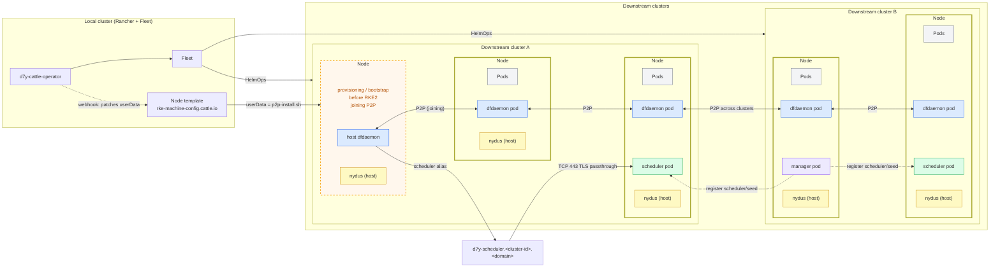

# d7y-cattle-operator

Kubernetes operator that runs [Dragonfly](https://d7y.io) P2P on Rancher-managed
RKE2 clusters.

**Status**: v0.2.0 (2026-11-20). The operator implements the Cluster controller,
role resolution, KeyDB, manager, seed role, manager registration,
`dragonfly-extras`, the fail-open `p2p-static` bootstrap, the CREATE-only
machine-config webhook, manager root credentials, and host nydus. Harbor,
registry-proxy, and the pod-image admission webhook are out of scope.

## What it does today

Pod image-mutation admission, Harbor, and registry-proxy add-ons are out of scope.
The CREATE-only machine-config webhook is kept: it injects the `p2p-install.sh`
bootstrap payload for the kept `p2p-static` chart.

- Parses and validates the operator configuration from flags/environment variables.
- Ensures a single mTLS CA and leaf certificate Secret (`dragonfly-p2p-mtls` by
  default) in the operator namespace. The leaf carries the manager DNS names
  and the DNS-resolved public scheduler IP(s); node IPs and internal
  ClusterIPs are never added. The Secret is updated only when the SAN set
  changes, and a changed SAN set regenerates the CA and leaf because the old
  CA key is not persisted. The Secret is replicated into each Cluster namespace
  and delivered downstream through Fleet `downstreamResources`; Traefik
  forwards manager gRPC TLS without terminating it.
- Reconciles `provisioning.cattle.io/v1` Clusters selected by the
  `d7y-operator-cattle: "true"` label.
- Deploys KeyDB and the Dragonfly manager through Fleet HelmOps, without
  PersistentVolumeClaims. Dragonfly releases use the gorizond fork chart
  `dragonfly 1.10.1-patch.2`, which renders `server.grpc.tls` under `grpc`,
  adds TLS flags to the manager/scheduler `grpc_health_probe` commands, and
  keeps the scheduler headless Service upstream-shaped.
- Deploys the seed role (scheduler/control, seedClient+client/data) when
  `p2p.dragonfly.io/seed: "true"` and a scheduler cluster ID is present. Nydus
  is host-only: `p2p-install.sh` installs and supervises it on the node; the
  operator creates no nydus DaemonSet or HelmOp.
- Manages the manager Ingresses, the public scheduler TCP front, and optional
  VPAs through the shared `d7y-extras` HelmOp and the `dragonfly-extras`
  chart. The operator has no Ingress, IngressRouteTCP, or
  VPA RBAC and creates neither kind directly.
- Uses a JWT-authenticated manager REST client (`pkg/managerapi`) and a
  thread-safe scheduler ID allocator (`pkg/registry`) for seed registration:
  auto mode writes the server-assigned ID to both `scheduler-cluster-id` and
  the durable `scheduler-cluster-id-auto` marker; user-owned IDs are never
  overwritten and mismatches are reported via the `d7y.io/IdMismatch` condition.
  Missing records are recreated and relinked on every reconcile.
- Generates or repairs the manager root credentials Secret (`username`,
  `password`, `jwt-key`) and wires the password/JWT key into the manager; see
  [Manager root credentials](#manager-root-credentials).
- Publishes role/registration state as Cluster conditions
  (`d7y.io/RolesResolved`, `d7y.io/KeyDBReady`, `d7y.io/ControlReady`,
  `d7y.io/DataReady`, `d7y.io/Registered`) and updates them only when they
  change.
- Runs until it receives `SIGINT`/`SIGTERM`.

## How it works



Color legend: gray = workload pods, blue = dfdaemon, green = scheduler, purple = manager, yellow = nydus (host); orange dashed = node still provisioning before RKE2.

### At a glance

- The operator runs on the local Rancher/Fleet cluster. It reconciles every Cluster labelled `d7y-operator-cattle: "true"` and creates the Fleet HelmOps for KeyDB, manager, scheduler/seed, extras, and the containerd mirror. Its CREATE-only machine-config webhook patches the node template `userData` with `p2p-install.sh`.
- Every running downstream node has a dfdaemon pod, with nydus on the host; pods pull through the node-local proxy and Dragonfly distributes blobs P2P. The diagram shows a scheduler pod per seed cluster and the manager pod on a node in downstream cluster B.
- The orange dashed node in downstream cluster A consumes that patched `userData` before RKE2: it has only the host dfdaemon and nydus and is already joining P2P. The scheduler alias `d7y-scheduler.<cluster-id>.<domain>` is published by external-dns (or a wildcard zone) and used before RKE2 to bootstrap node/RKE2 image pulls.

### Multi-cluster topology

- The manager is a role, not a fixed local component: the diagram places the purple manager pod on a node in downstream cluster B, while any Cluster with `d7y-operator-manager` can run it; the operator stays on the local Rancher cluster. Green scheduler pods are per seed Cluster, and blue dfdaemon pods run on every running node. Manager and seed roles may be split across different Clusters, each with its own KeyDB/extras release.
- N downstream/seed Clusters have N scheduler IDs. Each seed Cluster runs its own scheduler + seed under its ID. The scheduler/seed for a new Cluster's ID runs in a seed Cluster reachable before the new Cluster's RKE2 (it cannot run in that Cluster before its own RKE2 exists); external-dns or a wildcard zone publishes `d7y-scheduler.<cluster-id>.<domain>`. In downstream cluster A, the orange dashed node is the pre-RKE2 bootstrap stage: its host dfdaemon joins P2P before RKE2 and any Kubernetes Pods exist.
- `p2p-install.sh` from the patched node-template `userData` + the host dfdaemon bootstrap start before RKE2 and pull node/RKE2 images via Dragonfly P2P from the scheduler/seed. This accelerates provisioning before the Kubernetes node starts; if the alias is unreachable, the script is fail-open and pulls directly.

## Follow-ups

- Remaining pilot work: cold cross-node P2P, fscache/EROFS on a kernel with
  `EROFS_FS_ONDEMAND`/`CACHEFILES_ONDEMAND`, and full envtest coverage. The
  manager/seed/nydus path is verified on the pilot.
- The extras chart's VPA targetRef names must be verified against live workload
  names in the pilot.
- The KeyDB chart is external: `enapter/keydb` `0.48.0` from
  `https://enapter.github.io/charts/`. It is not vendored in this repo. The
  HelmOp requests two active multi-master nodes with persistence disabled. See
  [Release](#release).

## Install

Install the published chart from the GitHub Pages Helm repository:

```bash
helm repo add gorizond https://gorizond.github.io/d7y-cattle-operator
helm repo update
helm install d7y-cattle-operator gorizond/d7y-cattle-operator \
  --namespace dragonfly-system \
  --create-namespace \
  --set manager.grpcDomain=manager-grpc.example.com \
  --set manager.apiURL=https://manager-api.example.com \
  --set nginx.staticURL=https://static.example.com \
  --set managerApiCredentialsSecret=dragonfly-manager-api \
  --set scheduler.domain=example.com
```

`scheduler.domain` has no default and is required. There is no public or
internal scheduler IP value: the public scheduler IP(s) are resolved at
reconcile time from `d7y-scheduler.<cluster-id>.<domain>`, and both bootstrap
nodes and DaemonSets use that public host. DNS changes are SAN changes, so they
rotate the CA and leaf and roll the Dragonfly workloads.

For local development use `charts/d7y-cattle-operator` instead of the repository
chart. The release tag (`v<chart version>`) and the default image tag
(`v<chart version>`) are kept in sync by the release workflow.

The operator reads credentials only from Secret names. No secret values are passed
through flags or chart values; `managerApiCredentialsSecret` is required by the
configuration contract. When the named Secret is absent, the
operator creates it in its own namespace with a generated manager root password
and JWT signing key; see [Manager root credentials](#manager-root-credentials).

### Configuration values

| Value | Environment variable | Description |
|---|---|---|
| `manager.grpcDomain` | `MANAGER_GRPC_DOMAIN` | Public manager gRPC hostname, without scheme |
| `manager.grpcPort` | `MANAGER_GRPC_PORT` | Public manager gRPC port used by schedulers; default `443` |
| `manager.apiURL` | `MANAGER_API_URL` | Public manager REST API URL (`https://`) |
| `nginx.staticURL` | `NGINX_STATIC_URL` | Base URL of the static asset server for the bootstrap payload |
| `nydus.mirrorURL` | `NYDUS_MIRROR_URL` | Optional HTTPS mirror path for nydus blobs in the bootstrap payload |
| `scheduler.domain` | `P2P_DOMAIN` | Base domain for `d7y-scheduler.<fleet-cluster-id>.<domain>`; required |
| `scheduler.clusterID` | `P2P_CLUSTER_ID` | Optional fallback when provisioning Cluster `status.clusterName` is empty |
| `managerApiCredentialsSecret` | `MANAGER_API_CREDENTIALS_SECRET` | Secret with `username`, `password`, and `jwt-key` for the manager API and manager root login; generated by the operator when absent |
| `dragonfly.chart.repo` | `DRAGONFLY_CHART_REPO` | Helm repository URL of the Dragonfly chart; defaults to the gorizond fork |
| `extras.chart.repo` | `EXTRAS_CHART_REPO` | Helm repository URL of the dragonfly-extras chart |
| `extras.chart.name` | `EXTRAS_CHART_NAME` | dragonfly-extras chart name |
| `extras.chart.version` | `EXTRAS_CHART_VERSION` | dragonfly-extras chart version |
| `extras.ingress.controller` | `EXTRAS_INGRESS_CONTROLLER` | `nginx` (default) or `traefik` |
| `extras.ingress.className` | `EXTRAS_INGRESS_CLASS_NAME` | Ingress class; empty uses the cluster default |
| `extras.ingress.grpcEnabled` | `EXTRAS_INGRESS_GRPC_ENABLED` | Render the manager gRPC front when the manager role is active; default `true` |
| `extras.ingress.restEnabled` | `EXTRAS_INGRESS_REST_ENABLED` | Render the REST Ingress when the manager role is active; default `true` |
| `extras.ingress.tlsSecret` | `EXTRAS_INGRESS_TLS_SECRET` | Ingress TLS Secret; empty disables the TLS block |
| `extras.ingress.traefikServersTransportEnabled` | `EXTRAS_TRAEFIK_SERVERS_TRANSPORT_ENABLED` | Render the REST Traefik `ServersTransport`; default `true` |
| `webhook.enabled` | — | Render the machine-config webhook; default `true` |
| `webhook.port` | `WEBHOOK_PORT` | Webhook port; default `9443` |
| `webhook.certDir` | `WEBHOOK_CERT_DIR` | needacert TLS directory; default `/etc/webhook/certs` |
| `webhook.failurePolicy` | — | Machine-config webhook failure policy; default `Ignore` |

Defaults: `mtlsSecretName=dragonfly-p2p-mtls`, `dragonfly.chart.name=dragonfly`,
`dragonfly.chart.repo=https://gorizond.github.io/dragonflyoss-helm-charts`,
`dragonfly.chart.version=1.10.1-patch.2`, `extras.chart.name=dragonfly-extras`,
`extras.chart.version=0.1.10`, `extras.ingress.controller=nginx`,
`extras.ingress.grpcEnabled=true`, `extras.ingress.restEnabled=true`,
`manager.grpcPort=443`, `webhook.enabled=true`, `webhook.port=9443`,
`webhook.failurePolicy=Ignore`,
`leaderElect=false`. The public scheduler IP(s) are resolved from DNS at
reconcile time; there is no scheduler IP value. `scheduler.domain` has no
default and is required. `scheduler.clusterID` is only a fallback for an
unpopulated `status.clusterName`.

## Roles and Fleet targeting

Fleet matches `spec.targets[].clusterSelector` against provisioning Cluster
**labels**, so the gate and role labels are the only targeting contract. The
operator still resolves roles from annotations for its own decisions; the
matching role label must also be present for Fleet to render the shared release.

| Label | Value | Meaning |
|---|---|---|
| `d7y-operator-cattle` | `"true"` | Gate: opts the Cluster into the Dragonfly stack |
| `d7y-operator-manager` | `"true"` | Manager role (shared `d7y-manager`) |
| `d7y-operator-seed` | `"true"` | Seed role (shared control/data/extras/mirror) |

Role labels are user-managed: the operator only stamps
`p2p.dragonfly.io/cluster-id` (from `status.clusterName`, read by the scheduler
host template) and `p2p.dragonfly.io/scheduler-public-ip` (the resolved public
advertiseIP). Removing a role annotation is not enough to uninstall a shared
release; remove the role label too.

A Cluster labeled `d7y-operator-cattle: "true"` gets the shared KeyDB release.
The role annotations and matching labels add:

| Roles | HelmOps |
|---|---|
| gate only | `d7y-keydb` |
| `manager: "true"` | `d7y-keydb`, `d7y-manager` |
| `seed: "true"` + scheduler ID | `d7y-keydb`, `d7y-control`, `d7y-data`, `d7y-extras`, `d7y-containerd-mirror` |
| manager + seed | shared seed set + `d7y-manager` |

The `seed` annotation is independent of the manager role. Removing it deletes
the per-cluster seed HelmOps; the shared releases stop targeting the Cluster
only when the matching role label is removed.

### Shared HelmOps

A small fixed set of HelmOps fans out to Clusters by label selector. The HelmOp
name and Helm release name are fixed (`spec.helm.releaseName` is not
templatable); per-cluster resource names are rendered from Fleet values
templates.

| HelmOp / release | Component | Selector |
|---|---|---|
| `d7y-keydb` | KeyDB | `d7y-operator-cattle=true` |
| `d7y-manager` | manager + MySQL | `d7y-operator-cattle=true`, `d7y-operator-manager=true` |
| `d7y-control` | scheduler | `d7y-operator-cattle=true`, `d7y-operator-seed=true` |
| `d7y-data` | seedClient + client | same as control |
| `d7y-extras` | extras (public scheduler front, VPA, Ingress) | same as control |
| `d7y-containerd-mirror` | node containerd mirror | same as control |

The rendered values keep the per-cluster downstream names:

- `fullnameOverride`: `${ .ClusterName }` (manager),
  `${ .ClusterName }-keydb`,
  `${ .ClusterName }-control`, `${ .ClusterName }-data`
- Ingress/VPA backends: `${ .ClusterName }-manager`,
  `${ .ClusterName }-control-scheduler`, `${ .ClusterName }-data-seed-client`
- Scheduler public host:
  `d7y-scheduler.${ index .ClusterLabels "p2p.dragonfly.io/cluster-id" }.<domain>`
- Scheduler cluster ID and advertiseIP:
  `${ index .ClusterAnnotations "p2p.dragonfly.io/scheduler-cluster-id" }` and
  `${ index .ClusterAnnotations "p2p.dragonfly.io/scheduler-public-ip" }`

When a Cluster stops matching a selector, Fleet deletes its BundleDeployment
and uninstalls the release.

Legacy per-cluster objects (`<cluster>-keydb`, `<cluster>-manager`,
`<cluster>-control`, `<cluster>-data`, `<cluster>-extras`,
`<cluster>-containerd-mirror`) are deleted, HelmOp and Bundle, once the
corresponding shared HelmOp has been applied.

Existing annotation-driven Clusters must add the matching role label (for
example `d7y-operator-seed: "true"` next to `p2p.dragonfly.io/seed: "true"`):
Fleet selectors cannot read annotations. The operator never sets or removes
role labels.

### Known shared-HelmOp limitations

Fleet values templates cannot render booleans or YAML lists, so the shared
releases keep fixed defaults:

- `p2p.dragonfly.io/monitoring`: the per-Cluster selector is still resolved per
  cluster, but the shared releases keep chart metrics defaults (no forced
  ServiceMonitor).
- `p2p.dragonfly.io/p2p-data-tls`: the shared data release uses the default
  plaintext P2P data path.
- The shared extras release enables the manager Ingress unconditionally. A seed
  Cluster without a local manager renders an Ingress with no local backend.
- A seed-labeled Cluster without `p2p.dragonfly.io/scheduler-cluster-id`
  renders an empty scheduler ID; the seed label is the deployment contract.

### Pilot data resource sizing

The fork dragonfly chart defaults to `8 CPU / 16Gi` requests for `seedClient`,
which cannot fit three replicas on the pilot nodes. `pkg/helmop/data.go` pins:

| Workload | Requests | Limits |
|---|---|---|
| `seedClient` | `1 CPU / 2Gi` | `4 CPU / 8Gi` |
| `client` | `250m / 512Mi` | `2 CPU / 4Gi` |

The four demo nodes each have 16 CPU and 32,100 MiB allocatable. Before the
seed role they carried 8.7-10.3 CPU and 18.2-21.0 GiB of requests per node,
leaving 5.7-7.3 CPU and 10.4-13.1 GiB free. Three `seedClient` replicas plus
one `client` pod per node and two control schedulers add 4.25 CPU / 8.5 GiB
in total (1.5 CPU / 3 GiB on the busiest node), so all requests fit with at
least 4.2 CPU / 7.5 GiB still free per node. In the normal one-seed-per-node
spread, `seedClient` plus `client` plus a control scheduler also fit their
limits on a node (14 CPU / 28 GiB of 16 CPU / 31.3 GiB). The `seedClient`
hostNetwork ports 4100-4106 force the three replicas onto distinct nodes at
runtime.

The operator requires Rancher 2.15+ with Fleet 0.16+ (the `HelmOp` CRD).
The KeyDB chart (`enapter/keydb` `0.48.0`) is pinned in the operator; KeyDB is
external and is not published from this module. Nydus binaries are installed by
`p2p-install.sh`, not by an in-cluster chart. The shared KeyDB HelmOp runs two active masters (`nodes: 2`,
`multiMaster: "yes"`, `activeReplicas: "yes"`) with `persistentVolume.enabled:
false`, so it uses emptyDir and creates no PVC. The chart exposes the service as
`<cluster>-keydb:6379`.

### Status conditions

The operator writes conditions to `Cluster.status.conditions` and updates them
only when the value, reason, or message changes:

| Condition | True when |
|---|---|
| `d7y.io/RolesResolved` | The Cluster has the `d7y-operator-cattle: "true"` label; the role annotations are parsed. |
| `d7y.io/KeyDBReady` | The shared `d7y-keydb` HelmOp was applied. |
| `d7y.io/ControlReady` | The shared `d7y-control` HelmOp was applied and registration succeeded (`seed: "true"`). |
| `d7y.io/DataReady` | The shared `d7y-data` and `d7y-containerd-mirror` HelmOps were applied (`seed: "true"`). |
| `d7y.io/Registered` | Scheduler and seed-peer records were ensured and linked in the manager. |
| `d7y.io/RegistrationFailed` | Registration failed permanently; `d7y.io/Retrying` marks transient failures. |
| `d7y.io/IdMismatch` | The user-provided `scheduler-cluster-id` differs from the manager server ID; the annotation is preserved. |

A label-only Cluster reports `d7y.io/ControlReady=False` and
`d7y.io/DataReady=False` with reason `SeedDisabled`; a seed Cluster whose mTLS
Secret is missing reports `MTLSSecretUnavailable`. Conditions never contain
Secret values or certificate material.

### Dragonfly chart version

`dragonfly.chart.repo` defaults to
`https://gorizond.github.io/dragonflyoss-helm-charts` and
`dragonfly.chart.version` to the verified `1.10.1-patch.2` (appVersion
`2.5.4`). The fork carries these upstream-compatible patches:

- `server.grpc.tls` is rendered under `server.grpc`, so the manager actually
  serves gRPC over mTLS.
- The manager and scheduler startup/readiness/liveness probes pass
  `-tls -tls-ca-cert=... -tls-client-cert=... -tls-client-key=...` when the
  matching TLS configuration is set.
- The scheduler Service uses the real container gRPC port and honours
  `scheduler.config.server.tls`; `server.grpc.tls` is accepted as an alias and
  `server.rest.tls` is rejected as manager-only.
- The scheduler keeps its upstream-shaped headless peer Service. Only the
  public TCP front is rendered by `dragonfly-extras`; the fork chart adds no
  scheduler client Service.

Both values are passed to every Dragonfly HelmOp (`manager`, `control`,
`data`). A different version is allowed for experiments, but the operator
emits an `UnsupportedChartVersion` warning event on each reconcile because TLS
fields and topology control/data behavior may change between chart versions.
Pin the chart version in the operator release values; never hardcode it in Go
code. The fork is an external dependency of this repository: the chart is
pulled by Fleet at reconcile time and is not vendored here.

### Public scheduler front and P2P certificate

Bootstrap nodes need the scheduler before RKE2 (and therefore before Fleet
DaemonSets) exists. There is a single public front for both:

- A Traefik `IngressRouteTCP` named `<release>-scheduler` on the `websecure`
  entry point with `tls.passthrough: true`. Traefik never terminates TLS and no
  Let's Encrypt certificate or TLSOption is attached. The default
  ``HostSNI(`*`)`` matcher also covers clients that dial the public LB IP and
  send no SNI; set `scheduler.hostSNI` when the entry point is shared with
  another passthrough route. The backend is the fork chart's headless
  `<cluster>-control-scheduler` Service on port `8002`.
- Both bootstrap clients and DaemonSets use
  `d7y-scheduler.<cluster-id>.<domain>:443`. DaemonSets get that address from
  their local `dynconfig.yaml`; bootstrap clients get the public `advertiseIP`
  and `advertisePort=443` through the manager dynconfig and their local
  dynconfig. There is no internal scheduler ClusterIP Service.

The per-cluster DNS alias is
`d7y-scheduler.<fleet-cluster-id>.<scheduler.domain>`, where the cluster ID
comes from provisioning Cluster `status.clusterName` (with
`scheduler.clusterID`/`P2P_CLUSTER_ID` as an explicit fallback). The operator
resolves the alias at reconcile time with `net.LookupHost`; the resolved
address(es) become P2P leaf IP SANs and the first IPv4 address becomes the
scheduler `advertiseIP`. The extras chart publishes the alias with
`external-dns.alpha.kubernetes.io/hostname`; the target is derived from the
cluster's own load balancer, so the record follows the LB instead of a pinned
address. A deployment zone wildcard can also resolve it.
The P2P leaf carries both the resolved public IP SANs and the scheduler
hostname DNS SAN. IP SANs are required because Dragonfly client 1.5.14 verifies
the resolved IP; the DNS SAN keeps name-based callers working. It contains no
ClusterIP and no node IPs.

If DNS resolution fails or returns no addresses, the operator emits a
`SchedulerDNSResolutionFailed` event, keeps the existing certificate and its IP
SANs, and continues the reconcile with an empty `advertiseIP`. The shared
HelmOps, including the extras chart that publishes the alias, are still
applied, so a missing alias does not block the first deploy. A later reconcile
resolves the alias, adds the IP SAN, and rotates the certificate once. Existing
public IP SANs are preserved when a new answer arrives, so a DNS/IP rotation
keeps the old and new addresses valid during propagation.
`scheduler.config.server.advertiseIP` and `advertisePort=443` use the public
front; DaemonSets use the same public host from their local dynconfig.

### Fail-open node bootstrap

The `p2p-static` bootstrap script (`p2p-install.sh`) is fail-open so the first
node of a new cluster can join RKE2 even when the scheduler is not reachable
yet:

- It preflights the manager gRPC endpoint and the public scheduler host
  (DNS/TCP, short timeout).
- If scheduler/DNS/manager preflight fails, or dfdaemon/nydus download/startup
  fails, it removes the nydus containerd drop-in (containerd 2.x) or writes an
  overlayfs-only direct-registry template (1.x) and exits success. It does not
  enable the `127.0.0.1:4001` nydus proxy or the bootstrap services in that
  path.
- Existing certificate/config files are preserved, but no P2P services are
  enabled. A later successful run (or an existing seed cluster) installs the
  full public-P2P configuration.
- Nydus is installed on the host: the patched `containerd-nydus-grpc`
  snapshotter release `v0.16.0-p2p.2` plus static-store `v0.16.0` `nydusd`,
  `nydus-image`, and `nydus-overlayfs` assets. It is the global CRI
  snapshotter. `enable_oci_tar` is not set (it is not a nydus field). A daily
  host timer runs `nydus-updater` to refresh the static assets and restart the
  host unit only when something changed; the patched snapshotter is updated by
  rerunning `p2p-install.sh`.
- Host `dfdaemon-bootstrap` is the cold-start P2P client. A boot helper starts
  it before RKE2 even if the switch disabled it at the previous shutdown; a
  30s host timer detects the node's in-cluster `client` pod via `crictl` and
  disables the host bootstrap while the pod is running. If the pod disappears,
  the timer re-enables the host bootstrap. The switch never touches nydus.

Certificate rotation is controlled by a pod template annotation:
`p2p.dragonfly.io/cert-revision` is the SHA-256 of `tls.crt`. It is added to
the manager Deployment, the control scheduler StatefulSet, and the data
seedClient/client workloads. A stable SAN set keeps the annotation stable, so
normal reconciles do not roll pods; a real certificate change rolls each
workload exactly once. `EnsureSecret` also removes the
`kubectl.kubernetes.io/last-applied-configuration` annotation because it can
contain a copy of `tls.key`.

### Port security

Dragonfly peers use `hostNetwork`, so Kubernetes NetworkPolicy does not cover
their node ports. Enforce the following with node firewall rules and cloud
security groups:

| Ports | Purpose | Exposure |
|---|---|---|
| `8002` | Scheduler gRPC backend | mTLS required; reachable only from the Traefik pod network, never exposed publicly |
| `4000` | dfdaemon upload | Plaintext by default; allow only cluster peers/scheduler. Set `p2p-data-tls` to require mTLS. |
| `4001/4002/4003/4004` | client proxy/metrics/health/stats | bind to `127.0.0.1`; do not expose |
| `4005/4006` | client storage TCP/QUIC | cluster network only |
| `4100` | seedClient upload | Plaintext by default; allow only cluster peers/scheduler. Set `p2p-data-tls` to require mTLS. |
| `4101/4102/4103/4104` | seedClient proxy/metrics/health/stats | bind to `127.0.0.1`; do not expose |
| `4105/4106` | seedClient storage TCP/QUIC | cluster network only |
| `65003` | manager gRPC backend | mTLS end-to-end; Traefik only forwards TCP; never plaintext |
| `443` | manager gRPC edge / scheduler TCP front | manager gRPC: TCP TLS passthrough, client mTLS terminates at manager; scheduler: TCP TLS passthrough |
| `8080` | manager REST | JWT required; public Ingress is allowed |

Do not use `proxy.basicAuth` for peer authentication: chart 1.10.1-patch.2
places it in the wrong configuration block. The operator keeps `proxy`, `metrics`, `health`,
and `stats` on `127.0.0.1` for both `client` and `seedClient`. Because both
DaemonSets may run on the same node, seedClient ports are shifted to
`4100–4106` so they do not collide with client `4000–4006`.

All releases target `dragonfly-system` and depend on each other through
`spec.dependsOn`: the shared control depends on shared KeyDB, shared data
depends on shared control, KeyDB, and extras (which owns the public scheduler
TCP front), the shared mirror depends on shared data, and the shared manager
depends on shared KeyDB. Shared extras has no dependency because the manager
name is templated. The mTLS Secret and the manager credentials Secret (names
via `mtlsSecretName` and `managerApiCredentialsSecret`) are copied into the
HelmOp namespace and delivered downstream through Fleet
`spec.downstreamResources`.

### Extras chart

The `dragonfly-extras` chart owns the manager gRPC/REST Ingresses and the
recommendation-only VPAs. The operator creates the shared `d7y-extras` HelmOp:

- `ingress.enabled` is always true for the shared release; Fleet cannot
  template the boolean manager role. The Ingress backend Service names are
  templated as `${ .ClusterName }-manager`. The per-Ingress toggles
  are `ingress.grpc.enabled` and `ingress.rest.enabled`; both default to `true`.
- `ingress.controller=nginx` (default) terminates client mTLS at the edge,
  serves the P2P certificate for the gRPC host, and reaches the manager with
  `backend-protocol: GRPCS`, `proxy-ssl-secret` (the P2P Secret, which carries
  `ca.crt` for backend verification and `tls.crt`/`tls.key` as the client
  certificate), `proxy-ssl-verify: "on"` and `proxy-ssl-name` set to
  `ingress.grpc.host`. Client certificates are verified at the edge from
  `dragonfly-p2p-mtls`; REST keeps `backend-protocol: HTTPS` and the public
  certificate.
- `ingress.controller=traefik` renders a `traefik.io/v1alpha1` `IngressRoute`
  named `<release>-manager-api` for the REST backend (Traefik v3 ignores
  `traefik.ingress.kubernetes.io/service.serversscheme`). The route uses
  `scheme: https` and, when enabled, references the `ServersTransport` named
  `<release>-manager-rest` in the release namespace; that resource uses
  `insecureSkipVerify: true`. The REST Ingress is not rendered in Traefik mode,
  and no nginx annotations are added.
- In Traefik mode the manager gRPC endpoint is an `IngressRouteTCP` named
  `<release>-manager-grpc` (CRD `traefik.io/v1alpha1`, entry point `websecure`)
  with exact `HostSNI` matching `ingress.grpc.host`, backend
  `ingress.grpc.service:ingress.grpc.port` (65003), and
  `tls.passthrough: true`. Traefik does not terminate TLS or proxy HTTP/2;
  the manager verifies the client certificate end-to-end. There is no TLS
  Secret, `TLSOption`, `ServersTransport`, or CA-only Secret on this path, so
  no HTTP router competes with the exact SNI.
- `ingress.controller=nginx` keeps its existing GRPCS + client-mTLS Ingress
  path for compatibility. Traefik mode never renders an HTTP manager-gRPC
  IngressRoute or ServersTransport.
- REST keeps its own `<release>-manager-rest` `ServersTransport` with
  `insecureSkipVerify: true`; the REST IngressRoute uses `scheme: https` and
  the public certificate.
- When the seed role is active, the chart also renders `<release>-scheduler`
  (`traefik.io/v1alpha1` `IngressRouteTCP`, `websecure`) with
  `tls.passthrough: true`, `HostSNI` from `scheduler.hostSNI`
  (default `*`), and the fork chart's headless scheduler Service as backend.
  It adds external-dns hostname/target annotations built from
  `scheduler.clusterID` and `scheduler.domain`. There is no certificate, TLSOption, or
  ServersTransport on this path, and it is independent of the manager
  `ingress.enabled` toggle.
- `ingress.tls.enabled` adds the public REST TLS block using
  `ingress.tls.secretName`. Manager gRPC uses TCP passthrough and does not
  attach a certificate; `ingress.grpc.tlsSecret` is nginx-only.
- Operator chart settings for the canary:

  ```yaml
  extras:
    ingress:
      controller: traefik
      className: traefik
      grpcEnabled: false
      restEnabled: true
      tlsSecret: dragonfly-p2p-mtls
  ```
- The manager gRPC server serves TLS with client mTLS on `:65003` using the
  mounted `/etc/dragonfly/certs` material; the edge controller must therefore
  use an HTTPS/GRPCS backend with the P2P client certificate. The manager REST
  server keeps its internal `/etc/dragonfly/certs` certificate because REST
  stays HTTPS between Traefik/nginx and the manager. No cert-manager or Let's
  Encrypt resources are part of this repo; the public REST TLS Secret is
  supplied directly on the cluster.
- `vpa.enabled` is set from API discovery for `autoscaling.k8s.io/v1`; the
  chart additionally checks `Capabilities.APIVersions.Has`. Target names are
  `<cluster>-keydb`, `<cluster>-manager`, `<cluster>-control-scheduler`,
  and `<cluster>-data-seed-client`; the shared release enables the keydb,
  manager, control, and data targets. Nydus is host-only and has no VPA
  target.
- The chart creates no PVC. The operator creates and replicates the mTLS
  Secret; the chart no longer renders a CA-only Secret. The operator RBAC
  remains limited to Clusters, HelmOps, Secrets, and Events.

## Host nydus snapshotter

`p2p-install.sh` installs the patched host snapshotter from
`gorizond/nydus-snapshotter` release `v0.16.0-p2p.2` (asset
`nydus-snapshotter-linux-amd64` plus its `.sha256`) to
`/usr/local/bin/containerd-nydus-grpc`; the existing
`nydus-snapshotter-bootstrap.service` runs it. The patched build reads
containerd's `certs.d/<host>/hosts.toml` (RKE2 path
`/var/lib/rancher/rke2/agent/etc/containerd/certs.d`, then
`/etc/containerd/certs.d`), so a `docker.io` pull resolves through the same
mirror and headers that containerd used for the pull. Without a certs.d
override it keeps the previous `docker.io` -> `registry-1.docker.io` behavior.

The installer defaults are `NYDUS_SNAPSHOTTER_REPO=gorizond/nydus-snapshotter`,
`NYDUS_SNAPSHOTTER_VERSION=v0.16.0-p2p.2`, and
`NYDUS_SNAPSHOTTER_ASSET=nydus-snapshotter-linux-amd64`; override them for
another fork release. The other nydus daemon assets (`nydusd`, `nydus-image`,
`nydus-overlayfs`) stay pinned in the static store at `NYDUS_VERSION`
(`v0.16.0`). A missing release asset falls back to the direct registry so RKE2
can still start. There is no MITM proxy or local CA on the node.

The `containerd-mirror` chart is created only for seed clusters
(`p2p.dragonfly.io/seed: "true"`) and writes only
`certs.d/_default/hosts.toml` pointing at dfdaemon
`127.0.0.1:4001`. There are no per-registry `docker.io`/`index.docker.io`
files and no `X-Dragonfly-Registry` headers: dfdaemon 1.5.14 infers the
upstream registry from containerd's `?ns=` and passes it to the proxy. The
DaemonSet reconciles the `_default` file periodically and removes the legacy
per-registry files written by older chart versions; non-seed clusters get no
`_default` from the operator.

## Cluster annotations

The operator only acts on Clusters labeled `d7y-operator-cattle: "true"`.

| Annotation | Value | Effect |
|---|---|---|
| `p2p.dragonfly.io/manager` | `"true"` | Manager role: manager and its database, KeyDB as external Redis |
| `p2p.dragonfly.io/seed` | `"true"` | Seed role: scheduler, seed client/client (nydus runs on the host) |
| `p2p.dragonfly.io/scheduler-cluster-id` | integer | Scheduler cluster ID; the seed role requires one, and when absent the operator auto-allocates it and writes both `scheduler-cluster-id` and the durable `scheduler-cluster-id-auto` marker. User-owned IDs are never overwritten. |
| `p2p.dragonfly.io/scheduler-replicas` | integer | Scheduler replicas (default `1`) |
| `p2p.dragonfly.io/seedclient-replicas` | integer | Seed client replicas (default `1`) |
| `p2p.dragonfly.io/monitoring` | label selector, `true`, or `enabled` | Enable metrics and ServiceMonitors for manager/scheduler/seedClient/client when the selector matches the Cluster labels; empty, invalid, or non-matching disables. Requires the Prometheus Operator ServiceMonitor CRD. |
| `p2p.dragonfly.io/p2p-data-tls` | `"true"` or `"enabled"` | Keep mTLS on the P2P data path (`seedClient`/`client` upload and scheduler `seedPeer`). Default/off uses plaintext P2P data; scheduler server, manager gRPC/API, and monitoring TLS are unaffected. |

When monitoring is enabled, a Dragonfly component with `enable=false` is
explicitly given `metrics.enable=false` and `metrics.serviceMonitor.enable=false`
so the fork chart does not render an empty metrics Service for it. When
monitoring is disabled, the operator leaves the chart metrics defaults
untouched.

P2P data TLS is disabled by default. The operator omits the upload server/client
certificate paths from both data workloads and the scheduler `seedPeer.tls`
block. Set `p2p.dragonfly.io/p2p-data-tls: "enabled"` (or `"true"`) to restore
mTLS on the data path. Scheduler `server.tls`, manager gRPC/API TLS, and
monitoring TLS are always retained. The bootstrap `p2p-install.sh` config keeps
scheduler control TLS and leaves upload plaintext, matching the cluster default.

## Manager root credentials

The manager credentials Secret (`managerApiCredentialsSecret`) is the source of
truth for both the operator's manager REST sign-in and the manager's initial
root account. The operator ensures the Secret in its own namespace, then copies
it into the shared manager HelmOp namespace so Fleet can deliver it into
`dragonfly-system` on every manager-labeled Cluster.

| Key | Meaning | Operator behaviour |
|---|---|---|
| `username` | Manager API/root login name | Preserved when non-empty; otherwise set to `root` |
| `password` | Manager API/root password, 8–20 characters | Preserved when valid; otherwise a generated 16-character alphanumeric password |
| `jwt-key` | Manager JWT signing key | Preserved when non-empty; otherwise 32 random bytes encoded as a 43-character base64url string |

The manager chart has no admin-password value. The operator renders two
`manager.extraEnvVars` entries as `secretKeyRef`s against the Secret:

- `DRAGONFLY_INITIAL_ROOT_PASSWORD` → key `password`
- `MANAGER_AUTH_JWT_KEY` → key `jwt-key`

Only the Secret name and key names are written to Helm values; the values stay
in the Kubernetes Secret and are never logged. The initial root user is created
only while the manager users table is empty. The manager database is ephemeral,
so after a database reset the env var re-seeds the same root password instead of
the chart default. A pre-existing non-root `username` is preserved, but the
initial-root env var only seeds the `root` account.

## Manager API client and scheduler ID allocator

`pkg/managerapi` is a stdlib-only client for the Dragonfly v2.5.4 manager REST
API:

- JWT `POST /api/v1/users/signin` with `name`/`password` (the Secret key remains
  `username`); response `token` + `expire`; Bearer auth; one re-signin on 401.
- List/create SchedulerCluster and SeedPeerCluster, GET by ID, and idempotent
  `Ensure*` helpers.
- Pagination follows the `Link` header `rel=next`; list responses may be `null`
  (treated as empty) and `page`/`per_page`/exact `name` filters are supported.
- SeedPeerCluster → SchedulerCluster linking uses the explicit
  `PUT /api/v1/seed-peer-clusters/{seed_id}/scheduler-clusters/{scheduler_id}`
  endpoint; the create bodies never send `id`, `seed_peer_cluster_id`, or
  `scheduler_cluster_id`.
- 404 → `ErrNotFound`, 409 → `ErrConflict` (re-read), 401/403 → auth failure,
  422 → `ErrUnprocessable` (no retry); 5xx/timeouts surface as errors for the
  controller's future backoff.
- `block_list` is sent as an empty object (`{}`) because the contract expects an
  object and the nested shape is not confirmed.

`pkg/registry` allocates scheduler cluster IDs with a mutex and cache: ID 1 is
reserved, automatic allocation starts at 2, manager IDs are skipped, an
existing annotation is returned unchanged and never overwritten, and repeated
or concurrent calls for the same cluster return the cached ID.

The seed reconcile uses both packages: it ensures the SchedulerCluster and
SeedPeerCluster by exact name, links them with the explicit PUT endpoint, and
writes the server-assigned ID to `scheduler-cluster-id` plus the durable
`scheduler-cluster-id-auto` marker in auto mode. If the marker equals
`scheduler-cluster-id`, the ID is auto-owned and may be updated after manager DB
loss; if the marker is absent or different, the ID is user-owned and is never
overwritten (`d7y.io/IdMismatch` on server mismatch). This decision survives operator
restarts. Registration failures set `d7y.io/RegistrationFailed` or `d7y.io/Retrying` and block
control/data without blocking manager/KeyDB.

## Bootstrap static chart

`charts/p2p-static` serves `/p2p-install.sh` and the static asset volume through
Nginx. The bootstrap payload is a base64url **env-file** (no JSON, no `jq`, no
python on the node). The script installs the host-only patched nydus
snapshotter (`v0.16.0-p2p.2`) plus the static `v0.16.0` daemon assets
(including `nydus-overlayfs`), writes the global nydus containerd drop-in
`config-v3.toml.d/90-nydus.toml`, starts it before RKE2, and installs a daily
host updater. There is no in-cluster nydus DaemonSet or HelmOp. See
`charts/p2p-static/README.md` for values, payload keys, drop-ins, and pilot
risks.

## Known pilot risk: extras target names

The Ingress backends and VPA targetRefs assume the Dragonfly chart workload
names above. Verify them against the live release in the pilot, especially the
`data` StatefulSet (`<cluster>-data-seed-client`) and the `control` StatefulSet
(`<cluster>-control-scheduler`). The extras chart falls back to derived names
when explicit names are empty, but the operator always sets them.

The nginx gRPC Ingress reads `auth-tls-secret` and `proxy-ssl-secret` from
`dragonfly-system`; the operator must be installed there (the default
`namespace`) so the P2P Secret is present in the Ingress namespace.

## Known pilot risk: fork chart dependency

The operator defaults to the external fork
`https://gorizond.github.io/dragonflyoss-helm-charts` and pins
`dragonfly 1.10.1-patch.2`. The chart is not vendored into this repository; if
the fork pages or repository disappear, every Dragonfly HelmOp fails to
install. The fork is an interim dependency until the two patches are merged
upstream. When upstream publishes an equivalent release, re-run the fork chart
TLS checks against it and switch `dragonfly.chart.repo/version` back to the
upstream repository in a separate change.

Manager gRPC uses the Traefik `IngressRouteTCP` and `tls.passthrough` fields,
which are long-standing CRD fields. The REST `ServersTransport` continues to
use the verified `serverstransports.traefik.io` schema; a Traefik downgrade
that predates those fields would affect REST only.

## Known pilot risk: host-only nydus

Nydus runs only on the host, installed by `p2p-install.sh`; the operator no
longer creates a nydus chart, DaemonSet, HelmOp, RuntimeClass, or VPA. The
script installs the patched `v0.16.0-p2p.2` snapshotter plus static `v0.16.0`
daemon assets (including `nydus-overlayfs`), writes `/etc/nydus/config.toml`
(multiple/fusedev, `[experimental]` `enable_referrer_detect`/
`enable_index_detect`, no tarfs), the registry-backend `nydusd-config.json`,
and the global containerd drop-in. It starts the host unit before RKE2 and runs
a daily updater for the static binaries. Do not add
`enable_oci_tar` (it is not a nydus field). Pilot must verify the drop-in merge
with `containerd config dump`, the v0.16.0-p2p.2 unit flags, and the host restart
procedure. Tarfs is intentionally disabled; enabling it requires kernel >= 6.4
and a matching nydusd. Ordinary-OCI Zran is not claimed.

## Development

Go 1.26 is required because the operator builds against the Rancher 2.15 and
Fleet 0.16 API machinery used by the target management cluster.

Docker is the source of truth for builds and tests:

```bash
make docker-build   # container image
make docker-test    # go test ./... inside Docker
make lint           # go vet ./... inside Docker
make helm-lint      # helm lint every chart under charts/
make helm-template  # render the operator, extras, p2p-static, and mirror charts
```

## Security notes

- The operator runs as UID/GID 65532 with a read-only root filesystem.
- mTLS private keys exist only in the `kubernetes.io/tls` Secret and are never logged.
- The operator uses only Wrangler/lasso Kubernetes clients (no client-go clientset
  or dynamic client) and requests no Ingress or VPA permissions.

## Release

Pushing a `v*` tag runs `.github/workflows/release.yml`:

- builds and pushes the operator image tagged with the Git tag
  (`v<chart version>`);
- lints every chart under `charts/` and publishes it with `chart-releaser` to
  the `gh-pages` branch.

The repository charts are `d7y-cattle-operator`, `dragonfly-extras`,
`p2p-static`, and `containerd-mirror`. The KeyDB chart is
external (`enapter/keydb` `0.48.0` from
`https://enapter.github.io/charts/`) and is not vendored or published here.
The operator pins that external chart and submits the three-master, no-PVC
values described above.

## License

Apache-2.0. See [LICENSE](LICENSE).
